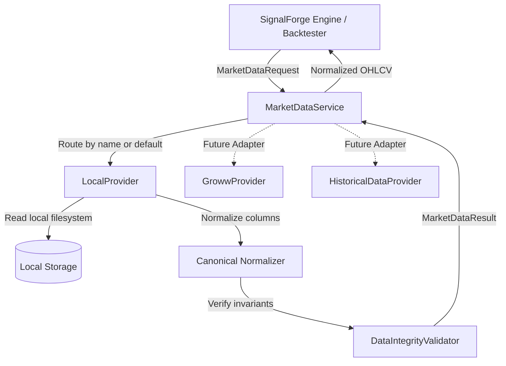

# Phase 10A: Provider-Agnostic Market Data Service Architecture

## 1. Objective

The objective of Phase 10A is to introduce a provider-agnostic, decoupled market-data abstraction layer for SignalForge. Prior to this phase, components interacted with market data through specific file readers or provider-dependent classes, which coupled downstream consumers (such as indicators, backtesters, signals, and replays) to concrete storage formats and acquisition scripts.

Phase 10A establishes a unified interface that:
- Isolates downstream trading logic from data vendor details.
- Defines strict data request and result contracts.
- Enforces canonical OHLCV normalization and invariant validation.
- Coordinates data retrieval across multiple providers without silent fallbacks.
- Prepares the groundwork for real-time and historical broker adapters (e.g. Groww, TickData) without modifying existing production datasets.

---

## 2. Architecture & Lifecycles

SignalForge's data architecture is structured across four clean lifecycle stages:

```
[ RAW LANDING ]
       │
       ▼ (Column / Format normalization)
[ NORMALIZED STAGING ]
       │
       ▼ (Schema, temporal, and invariant validation)
[ VALIDATED DATASET ]
       │
       ▼ (Production deployment / Manifest audit trail)
[ PRODUCTION READY ]
```

Phase 10A sits at the boundary of data provisioning and consumption:
- **`MarketDataRequest`**: Encapsulates user or engine intent (symbol, exchange, interval, timeframe range, adjusted status).
- **`MarketDataService`**: Acts as the single entry-point registry and router.
- **`MarketDataProvider` (ABC)**: Abstract provider contract implemented by storage or vendor drivers.
- **`LocalProvider`**: Concrete implementation serving existing local datasets (`.csv` or `.parquet`) from production storage without external downloads.
- **`MarketDataResult`**: Normalized envelope delivering canonical OHLCV bars alongside cryptographic audit metadata.



---

## 3. Provider Interface & Abstract Contract

All providers implement the `MarketDataProvider` abstract base class defined in [`src.data.market_data`](file:///c:/Study%20Roadmap/PROJECTS/SignalForge/src/data/market_data.py) and re-exported in [`src.data.providers.base`](file:///c:/Study%20Roadmap/PROJECTS/SignalForge/src/data/providers/base.py):

```python
class MarketDataProvider(ABC):
    @property
    @abstractmethod
    def provider_name(self) -> str:
        """Return the unique canonical identifier for this provider."""
        ...

    @abstractmethod
    def get_historical(self, request: MarketDataRequest) -> MarketDataResult:
        """Fetch historical market data matching the request."""
        ...

    @abstractmethod
    def is_available(self) -> bool:
        """Return True if this provider is available and ready to serve requests."""
        ...
```

---

## 4. Request & Result Models

### MarketDataRequest
An immutable, validated parameter model:
- `symbol`: String ticker (auto-stripped and converted to uppercase, e.g., `"TCS"`).
- `exchange`: Exchange identifier (defaults to `"NSE"`, uppercase).
- `interval`: Bar resolution (validated regex `^\d+(m|h|d|wk|mo)$`, e.g., `"1m"`, `"5m"`, `"1d"`).
- `start`: Optional range start (date/datetime/Timestamp/string).
- `end`: Optional range end (validated `start <= end`).
- `adjusted`: Boolean flag indicating corporate-action price adjustments (default: `False`).

### MarketDataResult
Standardized data envelope:
- `symbol`: Ticker symbol.
- `exchange`: Exchange identifier.
- `interval`: Interval string.
- `data`: `pandas.DataFrame` guaranteed to satisfy the canonical OHLCV contract.
- `provider`: String name of the provider that fulfilled the request.
- `requested_start` / `requested_end`: Boundaries requested by caller.
- `metadata`: Dictionary containing audit details (e.g., `source_file`, `file_checksum`, `row_count`, `storage_format`).

---

## 5. Normalized OHLCV Contract

The canonical data contract guarantees that all consumers receive uniform data structure regardless of provider:

1. **Temporal Index**: Must be a `pandas.DatetimeIndex`.
2. **Column Names**: Strictly Title Case:
   - `Open`
   - `High`
   - `Low`
   - `Close`
   - `Volume`
3. **Data Types**: All 5 OHLCV columns must have numeric dtypes (`float64` or `int64`).
4. **Ordering & Density**:
   - Monotonic ascending timestamps (`is_monotonic_increasing == True`).
   - Zero duplicate timestamps (`has_duplicates == False`).
   - Zero `NaT` (Not-a-Time) entries.
   - Zero `NaN` or missing values across the 5 canonical columns.
5. **Mathematical Invariants**:
   - $\text{High} \ge \text{Open}$
   - $\text{High} \ge \text{Close}$
   - $\text{Low} \le \text{Open}$
   - $\text{Low} \le \text{Close}$
   - $\text{High} \ge \text{Low}$
   - $\text{Volume} \ge 0$

Columns from external providers (e.g. `open`, `volume`, `OPEN`, `VOLUME`) are mapped to canonical Title Case via `normalize_ohlcv_columns()` before verification.

---

## 6. Validation Behavior & Reused Invariants

Rather than duplicating validation code, Phase 10A aligns with `src/data/validator.py` and `DataIntegrityValidator` in `src/data/acquisition.py`:
- `validate_normalized_ohlcv()` enforces the complete suite of canonical invariants.
- `LocalProvider` validates input data immediately upon loading and slicing.
- `MarketDataResult.__post_init__()` validates that any data packaged within the result adheres to the canonical contract.
- If any invariant fails, a descriptive `ValueError` or `TypeError` is raised.

---

## 7. Provider Selection & No-Silent-Fallback Policy

`MarketDataService` coordinates provider execution with zero silent fallback:
- **Explicit Selection**: Callers can request a specific provider via `get_historical(request, provider_name="...")`.
- **Default Provider**: When `provider_name` is omitted, `service.default_provider` is selected.
- **Strict Error Handling**:
  - Unregistered provider $\rightarrow$ `UnknownProviderError`.
  - Unavailable provider $\rightarrow$ `ProviderUnavailableError`.
  - Provider runtime error $\rightarrow$ Immediately propagated to caller.
- **Never Silently Fall Back**: If a selected provider fails (e.g. timeout, missing symbol, disk failure), the service **NEVER** catches the exception to switch to a secondary or default provider. Silent switching can cause lookahead bias, inconsistent price adjustments, and silent data contamination during algorithmic evaluation.

---

## 8. Why Provider-Specific Logic Is Isolated

1. **Exchange & Vendor Format Divergence**: Different providers return data in varying formats (JSON payloads, streaming websockets, CSVs, compressed Parquet, diverse timestamp formats like epoch millis or ISO8601 strings with various timezones).
2. **Authentication & Rate Limits**: Live broker APIs require API keys, OAuth tokens, and rate limit throttling. These concerns should never leak into algorithmic models or backtesting engines.
3. **Testing Determinism**: Decoupling allows unit and integration tests to use mock or local filesystem providers without external network access or mocking complex vendor client libraries.

---

## 9. Future Provider Adapters

### Future Groww Adapter (`src/data/providers/groww.py`)
- Will implement `MarketDataProvider`.
- Translates `MarketDataRequest` into Groww's REST / WebSocket API calls.
- Normalizes Groww-specific candle structures to `Open, High, Low, Close, Volume`.
- Manages credentials via environment variables or secret vaults (never committed to repository).
- Implements `is_available()` by pinging authentication or session endpoints.

### Future Historical Data Provider (`src/data/providers/tickdata.py` or similar)
- Adapter for institutional data vendors (TickData, TrueData, GlobalDataFeeds).
- Downloads or queries high-density tick/bar datasets.
- Manages local disk caching while funneling through `src/data/acquisition.py` checksum and quarantine workflows.

---

## 10. Confirmation of Zero Downloads & Data Protection

> [!IMPORTANT]
> **Explicit Confirmation**:
> During Phase 10A, **NO real market data was downloaded**, and **NO external network requests were made**.
> All existing production stock datasets in `data/historical/stocks/*` and protected files (`src/data/downloader.py`, `src/validation/stock_data_readiness.py`) remained entirely untouched. All tests were executed using transient, isolated temporary files (`pytest`'s `tmp_path`) and in-memory mock providers.
