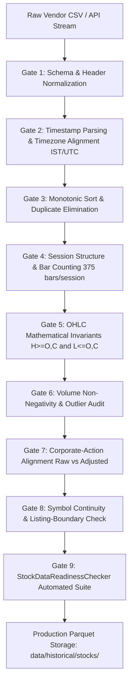

# SignalForge — Phase 6: Data Source Decision & Acquisition Plan

**Investigation Date**: September 11, 2026  
**System**: SignalForge Trading Analysis Platform  
**Document**: Phase 6 Master Data Architecture & Acquisition Plan  
**Status**: ACTIVE PLANNING & PROTOCOL SPECIFICATION  

---

## 1. Phase 6 Objective

The primary objective of Phase 6 is to establish the definitive, authoritative data source decision and operational acquisition roadmap for SignalForge's frozen historical market data. 

Having systematically evaluated retail web archives (Phase 1: Kaggle audit), retail broker APIs (Phase 2: Zerodha feasibility test), institutional market data vendors (Phase 3: Institutional source hunt), verified source capabilities (Phase 4: TickData source verification), and constructed an automated empirical test harness (Phase 5: Sample verifier & test suite), Phase 6 defines:
1. The formal classification and deployment status of all evaluated candidate sources.
2. The uncompromising enforcement of frozen production readiness criteria without date or quality relaxation.
3. The preferred vendor acquisition strategy conditioned upon physical evaluation proof.
4. The operational verification gates and legacy corporate-action mapping rules required before any historical data may be ingested into production.

---

## 2. Current Data Source Classification

The following matrix synthesizes the empirical evidence and production status of all evaluated data sources:

| Source | Coverage Evidence | Data Quality Evidence | Readiness Result | Production Status |
|---|---|---|:---:|:---:|
| **Kaggle Nifty 500 Intraday Dataset**<br>*(by debashis74017)* | 50/50 stocks audited. Earliest usable intraday data begins globally on **2015-02-02 09:15:00**. January 2015 (21 sessions) completely missing across all symbols. | Critical quality failures: severe synthetic flat forward-fill detected (700,000+ fake duplicate candles for `HDFCLIFE` and `SBILIFE` years prior to their actual IPOs). URL-encoding failure on `M&M`. | **FAILED**<br>Strict readiness failed (`first_timestamp <= 2015-01-01` violated). | **RESEARCH-ONLY**<br>Permanently disqualified from production ingestion. |
| **Zerodha Kite Connect Historical API** | 6-stock representative feasibility audit (`RELIANCE`, `TCS`, `INFY`, `HDFCBANK`, `ADANIENT`, `SBIN`). All 6 instruments start on **2015-02-02 09:15:00**. January 2015 is globally unavailable. | Clean intraday microstructure, valid OHLC geometry, genuine execution volumes, and authentic session boundaries, but limited by retail API historical depth boundary. | **FAILED**<br>Violates frozen `2015-01-01` inception mandate. | **SECONDARY CANDIDATE / RESEARCH-ONLY**<br>Suitable for recent paper trading & live validation, but disqualified for the frozen baseline. |
| **TickData (OneMarketData)** | Official exchange documentation confirms comprehensive coverage of all National Stock Exchange of India (NSE) cash equities dating back to **January 2, 2012** (3-year buffer prior to 2015). Pre-built 1-minute OHLCV trade bars available. | Millisecond timestamps, unadjusted and split/dividend-adjusted time series, authoritative corporate action audit logs, and patented **Ticker Mapping®**. | **PENDING**<br>Awaiting delivery and empirical parsing of physical evaluation files. | **PROMISING BUT UNVERIFIED**<br>Preferred candidate; must NOT be marked `VERIFIED PRIMARY` until physical sample passes verification. |

---

## 3. Frozen Production Requirements

SignalForge's data readiness requirements are **strictly frozen** and permanently enforced by `src/validation/stock_data_readiness.py`. Under no circumstances will validation thresholds, date boundaries, or data quality gates be weakened, compromised, or bypassed to accommodate the deficiencies of any vendor or dataset.

### Immutable Validation Parameters
* **Asset Class**: National Stock Exchange of India (NSE) Cash Equities.
* **Interval**: Exactly 1-Minute (`1m`) OHLCV trade bars.
* **Mandatory Inception Boundary**:
  $$\mathbf{REQUIRED\_START} = \mathbf{2015-01-01\ 00:00:00}$$
  *First legitimate NSE continuous trading session: `2015-01-01 09:15:00` IST.*
* **Mandatory Terminal Boundary**:
  $$\mathbf{REQUIRED\_END} = \mathbf{2024-03-26\ 15:29:00}$$
* **Required Data Schema**:
  - Index: `timestamp` (Pandas `DatetimeIndex`, timezone-aware or standardized IST/UTC)
  - Numeric Fields: `open`, `high`, `low`, `close`, `volume` (Float64 / Int64)
* **Mathematical Invariants**:
  $$High \ge \max(Open, Close)$$
  $$Low \le \min(Open, Close)$$
  $$Low > 0$$
  $$Volume \ge 0$$
* **Temporal Invariants**:
  - Strictly monotonic increasing timestamps ($t_i > t_{i-1}$) with zero duplicates.
  - Zero synthetic forward-filling across weekends, exchange holidays, or overnight closures.
  - Standard continuous trading sessions must contain 375 one-minute bars (`09:15` to `15:29` inclusive), with documented exceptions limited to exchange-scheduled partial sessions (e.g. Muhurat trading) or market-wide circuit breaker halts.

---

## 4. Preferred Acquisition Strategy

**TickData (OneMarketData)** remains SignalForge's preferred data source candidate **only pending physical sample verification**.

### Rationale for Preferred Status
1. **Unrivaled Historical Depth**: TickData is the only evaluated commercial provider that maintains an established, pre-built 1-minute historical intraday bar archive for NSE equities dating back to **January 2, 2012**. This provides a 3-year safety buffer prior to our frozen `2015-01-01` inception date.
2. **Turnkey Aggregation**: Unlike raw trade-by-trade exchange feeds (e.g., NSE Data & Analytics) which require processing billions of unaggregated multicast messages, TickData provides pre-compiled 1-minute OHLCV bars.
3. **Dual Corporate-Action Delivery**: TickData supplies both unadjusted raw trade bars and split/dividend-adjusted series, allowing exact microstructure modeling alongside adjusted backtesting.
4. **Authoritative Ticker Continuity**: Proprietary Ticker Mapping® resolves historical mergers, spinoffs, and renames.

### Conditional Nature of Preference
TickData's preferred ranking is strictly provisional. In accordance with SignalForge engineering standards, vendor marketing and documentation claims do not constitute verification. Procurement and production deployment remain blocked until empirical data is in hand and verified.

---

## 5. TickData Verification Gate

Before TickData can be promoted from `PROMISING BUT UNVERIFIED` to **`VERIFIED PRIMARY CANDIDATE`**, the physical evaluation sample for `RELIANCE` and `TCS` covering `2015-01-01` through `2015-03-31` must pass the automated empirical verifier:
```bash
python scripts/verify_tickdata_sample.py
```

### Empirical Pass Gate Criteria
To pass the gate, both sample files must achieve `status: PASS` across all 10 empirical checks:
1. **First Candle Check**: Exact presence of `2015-01-01 09:15:00` timestamp.
2. **Q1 Total Volume of Bars**: Exactly **22,875 bars** per stock across the 61 trading sessions of Q1 2015.
3. **January 2015 Completeness**: Exactly **7,875 bars** across the 21 trading sessions of January 2015 (resolving the Kaggle/Zerodha failure).
4. **Session Count**: Exactly 61 discrete trading sessions in Q1 2015.
5. **Session Bar Consistency**: 0 sessions deviating from the 375-bar regular session standard.
6. **Zero Duplicates**: Duplicate timestamp count == 0.
7. **Monotonic Chronology**: Timestamps strictly sorted in ascending order.
8. **Null Completeness**: 0 null/NaN values across OHLCV fields.
9. **OHLC Validity**: 0 violations ($H < O$, $H < C$, $L > O$, or $L > C$).
10. **Volume Validity**: 0 rows with negative volume.

Failure of either stock on any single check will result in immediate disqualification or a requirement for vendor remediation before any commercial procurement.

---

## 6. 50-Stock Acquisition Plan

Upon successful sample verification, SignalForge will execute a phased acquisition for the complete, frozen 50-stock universe.

> [!IMPORTANT]
> **No data will be downloaded or imported at this time.** The following architecture outlines the intended structure for future execution once the verification gate is passed.

### The Preserved 50-Stock SignalForge Universe
The 50 target instruments remain strictly preserved as defined:
```text
 1. ADANIENT       11. CIPLA          21. HINDUNILVR   31. MARUTI       41. SUNPHARMA
 2. ADANIPORTS     12. COALINDIA      22. ICICIBANK    32. MAXHEALTH    42. TATACONSUM
 3. APOLLOHOSP     13. DRREDDY        23. INDIGO       33. NESTLEIND    43. TATASTEEL
 4. ASIANPAINT     14. EICHERMOT      24. INFY         34. NTPC         44. TCS
 5. AXISBANK       15. ETERNAL        25. ITC          35. ONGC         45. TECHM
 6. BAJAJ-AUTO     16. GRASIM         26. JIOFIN       36. POWERGRID    46. TITAN
 7. BAJAJFINSV     17. HCLTECH        27. JSWSTEEL     37. RELIANCE     47. TMPV
 8. BAJFINANCE     18. HDFCBANK       28. KOTAKBANK    38. SBILIFE      48. TRENT
 9. BEL            19. HDFCLIFE       29. LT           39. SBIN         49. ULTRACEMCO
10. BHARTIARTL     20. HINDALCO       30. M&M          40. SHRIRAMFIN   50. WIPRO
```

### Staged Acquisition Waves
When authorized, acquisition will proceed in three structured waves:
* **Wave 1: Benchmark Majors (10 stocks)**: `RELIANCE`, `TCS`, `INFY`, `HDFCBANK`, `ICICIBANK`, `SBIN`, `BHARTIARTL`, `ITC`, `LT`, `HINDUNILVR`.
  - Objective: Establish core market index coverage and cross-validate multi-year macro trends.
* **Wave 2: High-Beta & Industrial Universe (25 stocks)**: Remaining continuous, long-lived large-cap equities.
* **Wave 3: Complex Mappings & Listing-Constrained Stocks (15 stocks)**: `TMPV`, `SHRIRAMFIN`, `TATACONSUM`, `ETERNAL`, `M&M`, `HDFCLIFE`, `SBILIFE`, `INDIGO`, `JIOFIN`, `MAXHEALTH`.
  - Objective: Execute specialized symbology mapping and listing-date boundary checks.

---

## 7. Legacy / Corporate-Action Mapping Rules

Historical symbols must be resolved through authoritative ticker mapping rather than silently treating a modern symbol as if it existed historically. Modern ticker symbols that underwent major corporate actions, mergers, or demergers must be mapped point-in-time to their predecessor entities:

### 7.1 Mandatory Symbology Mappings
1. **`TMPV` $\longrightarrow$ `TATAMOTORS`**:
   - `TMPV` (Tata Motors Passenger Vehicles) represents the successor passenger vehicle entity following Tata Motors' corporate demerger.
   - Historical data from `2015-01-01` through the demerger effective date must be mapped to original `TATAMOTORS` history to maintain a continuous 9-year trading record.
2. **`SHRIRAMFIN` $\longrightarrow$ `SRTRANSFIN`**:
   - Shriram Finance Ltd was created via the mega-merger of Shriram Transport Finance Company (`SRTRANSFIN`) and Shriram City Union Finance in December 2022.
   - Pre-2022 historical series must be mapped continuously from `SRTRANSFIN`.
3. **`TATACONSUM` $\longrightarrow$ `TATAGLOBAL`**:
   - Tata Consumer Products Ltd traded as Tata Global Beverages Ltd (`TATAGLOBAL`) prior to February 2020 (and previously Tata Tea).
   - Pre-2020 historical series must be mapped continuously from `TATAGLOBAL`.
4. **`ETERNAL` $\longrightarrow$ `ZOMATO`**:
   - Represents the corporate entity restructuring of Zomato Ltd.
   - Historical series begins on Zomato's official IPO listing date (`2021-07-23`) under `ZOMATO`.

### 7.2 Listing-History Constraints (Zero Pre-Listing Padding)
Unlike Kaggle, which artificially padded pre-IPO periods with hundreds of thousands of identical flat candles, SignalForge strictly mandates that post-2015 IPO stocks **must never receive synthetic pre-listing data**:
* **`HDFCLIFE`**: Listed on **2017-11-17 09:44:00**. Inception begins on listing date; no data prior.
* **`SBILIFE`**: Listed on **2017-10-03 13:40:00**. Inception begins on listing date; no data prior.
* **`INDIGO`**: Listed on **2015-11-10 09:44:00**. Inception begins on listing date; no data prior.
* **`MAXHEALTH`**: Listed on **2020-08-21 09:15:00**. Inception begins on listing date; no data prior.
* **`JIOFIN`**: Spun off and listed on **2023-08-21 09:15:00**. Inception begins on listing date; no data prior.

---

## 8. Data Integrity Gates

Before any downloaded data can be promoted to `data/historical/stocks/`, it must traverse a strict multi-tier integrity pipeline:



1. **Gate 1 (Schema Normalization)**: Verifies presence of `timestamp`, `open`, `high`, `low`, `close`, `volume`.
2. **Gate 2 (Timestamp Normalization)**: Coerces ISO-8601 strings, converts IST to UTC or standardized offset, checks for invalid/unparseable values.
3. **Gate 3 (Chronological Monotonicity)**: Asserts $t_i > t_{i-1}$ and verifies duplicates count == 0.
4. **Gate 4 (Session Alignment)**: Groups by trading date, verifies regular trading window (`09:15` to `15:29`), confirms 375 bars per full session.
5. **Gate 5 (OHLC Integrity)**: Validates $High \ge \max(Open, Close)$ and $Low \le \min(Open, Close)$ and $Low > 0$.
6. **Gate 6 (Volume Integrity)**: Rejects negative trade volume; flags volume gaps during active market hours.
7. **Gate 7 (Corporate-Action Reconciliation)**: Reconciles splits and cash dividends against exchange circulars.
8. **Gate 8 (Symbology & Listing Check)**: Enforces clean starts on IPO listing dates; maps predecessor tickers.
9. **Gate 9 (Readiness Gate)**: Evaluates through `StockDataReadinessChecker.check(symbol)`.

---

## 9. Production Promotion Rule

SignalForge enforces an absolute rule regarding production data promotion:

> **No data source becomes production-approved merely because a vendor claims coverage, displays marketing documentation, or provides external testimonials. Physical, authentic data files must be obtained, parsed, validated, and programmatically proven to satisfy all frozen readiness requirements through automated test execution.**

Any manual importation, forward-filling, or synthetic bridging of historical data into production directories is strictly prohibited.

---

## 10. Current Blocker

$$\mathbf{STATUS:\ BLOCKER\ ACTIVE}$$

**"TickData physical evaluation sample not yet received."**

* Details: The formal sample request for `RELIANCE` and `TCS` covering `2015-01-01` through `2015-03-31` (1-minute OHLCV, comma-delimited ASCII) was submitted to TickData Sales (`sales@tickdata.com`).
* Blocker Condition: Vendor delivery is currently pending. In accordance with safety rules, no payment was entered, no contract was signed, and no synthetic data was fabricated.

---

## 11. Next Action When Sample Arrives

As soon as TickData dispatches the sample evaluation files, the following deterministic protocol must be executed:

1. **Sample Placement**:
   - Place the raw `RELIANCE` sample file in:
     `research/tickdata_sample/RELIANCE/`
   - Place the raw `TCS` sample file in:
     `research/tickdata_sample/TCS/`
2. **Integrity Rule**:
   - **Do NOT edit, reformat, clean, or modify the vendor sample files.** They must be inspected in their exact delivered state.
3. **Run Verifier**:
   Execute the automated verification script:
   ```bash
   python scripts/verify_tickdata_sample.py
   ```
4. **Review Reports**:
   Inspect the automatically generated empirical reports:
   - `research/tickdata_sample_verification.md`
   - `research/tickdata_sample_verification.csv`
5. **Decision Execution**:
   - If both stocks achieve `status: PASS` (all 10 checks satisfied): Promote TickData to **`VERIFIED PRIMARY CANDIDATE`** and prepare commercial proposal.
   - If any check fails: Maintain `PROMISING BUT UNVERIFIED` or reclassify based on failure etiology.

---

## 12. Phase 6 Completion Criteria

Phase 6 is formally defined as complete when:
- [x] Data source classifications and audit results are comprehensively documented.
- [x] Frozen production readiness requirements are re-affirmed and locked against dilution.
- [x] Preferred acquisition strategy is formally specified pending sample verification.
- [x] Empirical TickData verification gate and pass criteria are established.
- [x] Full 50-stock acquisition framework is designed without premature downloads.
- [x] Legacy ticker mapping rules and IPO listing-boundary constraints are cataloged.
- [x] Multi-tier data integrity gates are defined.
- [x] Non-negotiable production promotion rule is enacted.
- [x] Current blocker and sample arrival protocols are clearly delineated.

All Phase 6 criteria are satisfied in this master plan.
