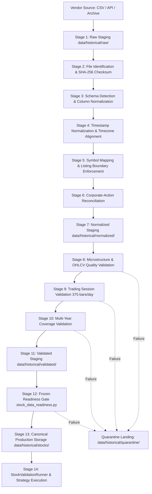

# SignalForge — Phase 7: Production Data Acquisition Architecture

**Date**: September 11, 2026  
**System**: SignalForge Trading Analysis Platform  
**Document**: Production Data Acquisition & Ingestion Architecture  
**Status**: ACTIVE ARCHITECTURAL SPECIFICATION & INFRASTRUCTURE  

---

## 1. Phase 7 Objective & Scope

The objective of Phase 7 is to design and implement the production-ready acquisition architecture for ingesting an authoritative, research-grade historical 1-minute OHLCV dataset for the 50-stock SignalForge universe.

Following the empirical audits of Kaggle (Phase 1), Zerodha Kite (Phase 2), the institutional market data vendor hunt (Phase 3), TickData source verification (Phase 4), automated verifier engineering (Phase 5), and the master data decision plan (Phase 6), Phase 7 bridges the gap between raw external data delivery and production-grade storage.

> [!IMPORTANT]
> **Strict Phase 7 Boundary**:
> - Zero market data is downloaded or connected in this phase.
> - TickData remains strictly classified as **`PROMISING BUT UNVERIFIED`** pending physical delivery of the evaluation sample.
> - SignalForge's frozen validation requirements (`REQUIRED_START = 2015-01-01`, `REQUIRED_END = 2024-03-26 15:29:00`) remain immutable.
> - No synthetic, forward-filled, or interpolated data is permitted.

---

## 2. End-to-End Ingestion Pipeline

The architecture processes market data through a strictly sequential, unidirectional pipeline where each stage enforces specific contracts and asserts invariants before allowing data to progress:



### 2.1 Pipeline Stages & State Classifications
The pipeline strictly enforces four distinct data tiers:

1. **`RAW` Tier**:
   - Files stored in `data/historical/raw/`.
   - Immutable staging area representing the exact bitstream received from the data provider.
   - Files are cryptographically fingerprinted using SHA-256 checksums and never modified in place.
2. **`NORMALIZED` Tier**:
   - Files stored in `data/historical/normalized/`.
   - Structural transformations applied: standard column naming (`timestamp`, `open`, `high`, `low`, `close`, `volume`), millisecond/second timestamp resolution, standardized timezone representation (IST / UTC), and explicit symbol mapping.
   - **Crucial Rule**: Passing normalization does **NOT** mean data is valid or ready for research.
3. **`VALIDATED` Tier**:
   - Files stored in `data/historical/validated/`.
   - Microstructure and session invariants verified: strict chronological order, zero duplicate timestamps, mathematical OHLC validity ($H \ge O, C$ and $L \le O, C$ and $L > 0$), non-negative volume ($V \ge 0$), 375 bars per full regular session, and zero synthetic padding.
4. **`PRODUCTION-READY` Tier**:
   - Files stored in `data/historical/stocks/{SYMBOL}_1m.parquet` (or `.csv`).
   - Only datasets that pass the automated `StockDataReadinessChecker` gate covering the entire frozen window (`2015-01-01` to `2024-03-26 15:29:00`) or legitimate post-2015 IPO listing boundaries are promoted to this tier.

---

## 3. Directory Contract

The system enforces an explicit physical and logical directory separation:

```text
data/
    historical/
        raw/          <-- Immutable vendor staging / landing zone
        normalized/   <-- Schema-normalized and timestamp-aligned staging
        validated/    <-- Datasets passing integrity and session gates
        quarantine/   <-- Quarantined failed files with diagnostic audit logs
        stocks/       <-- Canonical SignalForge production data (active universe)
research/
    phase7_production_data_architecture.md
```

### Directory Access Rules:
* `data/historical/raw/`: Read/Write for ingestion workers; append-only; immutable once written.
* `data/historical/normalized/`: Ephemeral or intermediate cache; generated deterministically from `raw/`.
* `data/historical/validated/`: Pre-production candidate holding area.
* `data/historical/quarantine/`: Destination for rejected files, paired with a `{filename}.rejection.json` error log. Failed source files are **never silently deleted**.
* `data/historical/stocks/`: Accessible by SignalForge production engine (`StockDataProvider`). Modified **only** via atomic promotion from `validated/`.

---

## 4. Canonical Internal OHLCV Data Contract

Every historical equity dataset promoted to production must adhere to the canonical SignalForge schema:

| Column Name | Storage Type | Pandas / Parquet Dtype | Nullable | Mathematical & Semantic Invariants |
|---|---|---|:---:|---|
| **`timestamp`** | Datetime | `datetime64[ns]` (or tz-aware) | **NO** | Strictly ascending ($t_i > t_{i-1}$); zero duplicates; normalized to bar start. |
| **`open`** | Float | `float64` | **NO** | $Open > 0$; first trade price during the 1-minute interval. |
| **`high`** | Float | `float64` | **NO** | $High \ge \max(Open, Close)$ and $High \ge Low$; maximum interval trade price. |
| **`low`** | Float | `float64` | **NO** | $Low \le \min(Open, Close)$ and $Low > 0$; minimum interval trade price. |
| **`close`** | Float | `float64` | **NO** | $Close > 0$; last trade price during the 1-minute interval. |
| **`volume`** | Float / Int | `float64` / `int64` | **NO** | $Volume \ge 0$; total shares executed in the bar. |

### Contract Violation Policy:
- **Zero Silent Repairs**: The system must never fabricate missing highs, interpolate lows, clamp negative volume to zero, or forward-fill missing bars.
- Any row violating mathematical invariants or containing nulls triggers immediate dataset rejection and transfer to `quarantine/`.

---

## 5. Trading Session Validation Architecture

For equities listed on the National Stock Exchange of India (NSE), continuous trading occurs between **09:15:00** and **15:30:00** IST. Standard 1-minute bars are indexed by their opening timestamp (`09:15` to `15:29`), yielding exactly **375 one-minute bars per full regular session**.

### 5.1 Session Classification Taxonomy
The ingestion engine evaluates every trading date against five deterministic categories:

1. **`COMPLETE_SESSION`**: Exactly 375 consecutive 1-minute bars from `09:15` to `15:29`.
2. **`PARTIAL_SESSION`**: Valid continuous session with fewer than 375 bars, accounted for by an authorized exchange circular:
   - **Muhurat Trading**: Annual 1-hour festive Diwali evening session (~60 bars).
   - **Market-Wide Circuit Breakers**: Exchange trading halts triggered by 10%, 15%, or 20% index circuit limits (e.g. COVID volatility halts on March 13 & 23, 2020).
   - **Exchange Technical Halts**: Hardware/telecom outages acknowledged by exchange notices (e.g. February 24, 2021).
3. **`MISSING_SESSION`**: Zero bars present on a date confirmed by the official NSE clearing calendar as an active trading day.
4. **`INVALID_SESSION`**: Session containing timestamp anomalies, gaps during unhalted regular trading hours, out-of-bounds timestamps (e.g., weekend bars, midnight bars), or irregular bar counts without a corresponding circular.
5. **`NON_TRADING_DAY`**: Saturdays, Sundays, and official exchange holidays (e.g., Republic Day, Independence Day, Gandhi Jayanti). Zero bars expected.

### 5.2 Exchange Calendar Interface
Holiday and calendar information will be supplied to the pipeline via a declarative, versioned exchange calendar schema (`NSETradingCalendar`). The ingestion engine cross-references candidate sessions against this calendar rather than blindly asserting 375 bars for every calendar date.

---

## 6. Symbol and Corporate-Action Mapping Architecture

SignalForge maintains an explicit, audited mapping registry. Historical tickers must never be silently rewritten into modern symbols without capturing provenance.

### 6.1 Mapping Record Schema
Every symbol transition is recorded as an immutable mapping object:
```python
@dataclass(frozen=True)
class SymbolMapping:
    current_symbol: str        # Modern SignalForge symbol
    historical_symbol: str     # Symbol used by vendor during the period
    effective_start: str       # ISO date string (YYYY-MM-DD)
    effective_end: str         # ISO date string or "CURRENT"
    mapping_reason: str        # Rationale (e.g. MERGER, DEMERGER, REBRANDING)
    source: str                # Vendor / Exchange Circular reference
    confidence: float          # 1.0 for confirmed exchange actions
```

### 6.2 Controlled Universe Symbology Mappings
The mapping policy is centralized in `src/data/acquisition.py`:

| Modern Symbol | Historical Predecessor | Effective Window | Mapping Rationale | Authoritative Reference |
|---|---|:---:|---|---|
| **`TMPV`** | `TATAMOTORS` | `2015-01-01` to `2024-03-26` | Tata Motors Passenger Vehicles demerger successor | Corporate Action Circular 2024 |
| **`SHRIRAMFIN`** | `SRTRANSFIN` | `2015-01-01` to `2022-12-05` | Shriram Transport Finance merged into Shriram Finance | NCLT Merger Sanction Dec 2022 |
| **`TATACONSUM`** | `TATAGLOBAL` | `2015-01-01` to `2020-02-10` | Tata Global Beverages rebranded to Tata Consumer | ROC Rebranding Feb 2020 |
| **`ETERNAL`** | `ZOMATO` | `2021-07-23` to `2024-03-26` | Zomato corporate restructuring and listing continuity | NSE Listing Circular Jul 2021 |

### 6.3 Listing-Era Boundary Constraints (Anti-Padding Rule)
Stocks listed after January 1, 2015 have hard physical listing date boundaries. The ingestion engine enforces strict clipping at the initial listing candle, rejecting any source file that supplies synthetic flat filler:

| Symbol | Exchange Listing Date | First Legitimate Candle | Pre-Listing Policy |
|---|:---:|:---:|---|
| **`HDFCLIFE`** | 2017-11-17 | `2017-11-17 09:44:00` IST | Zero pre-listing data permitted (Reject Kaggle 2015–2017 padding) |
| **`SBILIFE`** | 2017-10-03 | `2017-10-03 13:40:00` IST | Zero pre-listing data permitted (Reject Kaggle 2015–2017 padding) |
| **`INDIGO`** | 2015-11-10 | `2015-11-10 09:44:00` IST | Zero pre-listing data permitted |
| **`MAXHEALTH`** | 2020-08-21 | `2020-08-21 09:15:00` IST | Zero pre-listing data permitted |
| **`JIOFIN`** | 2023-08-21 | `2023-08-21 09:15:00` IST | Zero pre-listing data permitted |

---

## 7. Ingestion State Machine

Datasets transition through an auditable, explicit state machine. Each state transition requires programmatic verification; backward or illegal transitions are rejected:

```text
               ┌─────────────┐
               │  RECEIVED   │
               └──────┬──────┘
                      │ Validate Schema
                      ▼
               ┌─────────────┐
               │SCHEMA_VALID │
               └──────┬──────┘
                      │ Normalize Timestamps & Columns
                      ▼
               ┌─────────────┐
        ┌─────►│ NORMALIZED  │
        │      └──────┬──────┘
        │             │ Validate OHLCV & Volume
        │             ▼
        │      ┌─────────────┐
        │      │QUALITY_VALID│
        │      └──────┬──────┘
        │             │ Validate Sessions & Calendars
        │             ▼
        │      ┌─────────────┐
        │      │SESSION_VALID│
        │      └──────┬──────┘
        │             │ Validate Inception & End Bounds
        │             ▼
        │      ┌──────────────┐
        │      │COVERAGE_VALID│
        │      └──────┬───────┘
        │             │ Pass StockDataReadinessChecker
        │             ▼
        │      ┌────────────────────┐
        │      │READY_FOR_PRODUCTION│
        │      └────────────────────┘
        │
    Any Failure at any stage
        │
        ▼
   ┌──────────┐     ┌─────────────┐
   │ REJECTED │ ──► │ QUARANTINED │
   └──────────┘     └─────────────┘
```

### State Audit Logging:
Every state change writes an entry to the dataset's lifecycle log containing:
- `timestamp`: UTC timestamp of transition
- `from_state`: Previous state
- `to_state`: New state
- `reason`: Programmatic validation message or audit code
- `operator`: Automated worker or audit agent ID

---

## 8. Dataset Manifest & Provenance

Every ingested file is paired with an immutable JSON/CSV provenance manifest:

```json
{
  "dataset_id": "DS-RELIANCE-20150101-20240326-SHA256",
  "source": "TickData",
  "source_file": "data/historical/raw/RELIANCE_1m_2015_2024.csv",
  "symbol": "RELIANCE",
  "historical_symbol": "RELIANCE",
  "requested_start": "2015-01-01 00:00:00",
  "requested_end": "2024-03-26 15:29:00",
  "actual_start": "2015-01-01 09:15:00",
  "actual_end": "2024-03-26 15:29:00",
  "interval": "1m",
  "timezone": "Asia/Kolkata",
  "row_count": 845625,
  "checksum": "e3b0c44298fc1c149afbf4c8996fb92427ae41e4649b934ca495991b7852b855",
  "ingested_at": "2026-09-11T23:59:00Z",
  "validation_status": "READY_FOR_PRODUCTION",
  "validation_errors": [],
  "mapping_version": "1.0.0"
}
```

---

## 9. Idempotency & Re-Ingestion Behavior

1. **Deterministic Fingerprinting**:
   - The SHA-256 hash of the source file is computed upon landing in `raw/`.
   - If an identical file (matching checksum and symbol) is submitted for ingestion, the pipeline detects the matching fingerprint.
2. **Re-Ingestion Rules**:
   - If the existing dataset in `validated/` or `stocks/` is verified and unmodified, the pipeline logs a clean idempotent skip (`NOOP`).
   - If forced re-processing is requested (e.g. after a mapping rule update), the pipeline re-runs validation deterministically and atomically replaces the output file using atomic file swap (`os.replace`).
   - Re-ingestion will **never** create duplicate rows or alter existing unaffected symbols.

---

## 10. Quarantine Architecture

When a dataset fails any validation gate:
1. The problematic file is immediately moved out of the staging pipeline into `data/historical/quarantine/{symbol}_{timestamp}_{reason}/`.
2. A comprehensive diagnostic artifact `{filename}.quarantine_report.json` is generated alongside it, detailing:
   - Specific failure stage (e.g. `QUALITY_VALIDATION`, `SESSION_VALIDATION`)
   - Exact line numbers and timestamp ranges of violations
   - Mathematical nature of the breach (e.g. $High < Close$, negative volume)
3. Raw source files are preserved intact for forensic vendor feedback and remediation.

---

## 11. Production Promotion Protocol

Promotion to `data/historical/stocks/` requires passing through an atomic promotion gate:

1. **Pre-Condition**: Dataset must hold `READY_FOR_PRODUCTION` status.
2. **Readiness Check**: Ingestion runner executes `StockDataReadinessChecker(provider).check(symbol)`.
3. **Atomic Write**: Dataset is serialized to temporary file and swapped via atomic filesystem rename to prevent race conditions during reads.
4. **Validation Suite Trigger**: Ingestion triggers `StockValidationRunner` for automated signal and regression checks.

---

## 12. Implementation Summary

The following modular Python components in `src/data/acquisition.py` implement this architecture:
- `IngestionState` (Explicit lifecycle enum)
- `SymbolMapping` & `SymbolMappingRegistry` (Controlled historical mappings & listing limits)
- `DatasetManifest` (Full provenance data structure with JSON serialization)
- `DataDirectoryContract` (Safe path resolution across raw, normalized, validated, quarantine, and stocks)
- `DataIntegrityValidator` (Canonical OHLCV mathematical and temporal validation)
- `SessionValidator` (Categorization of NSE trading sessions)
- `compute_sha256` (Deterministic cryptographic file and buffer hasher)
