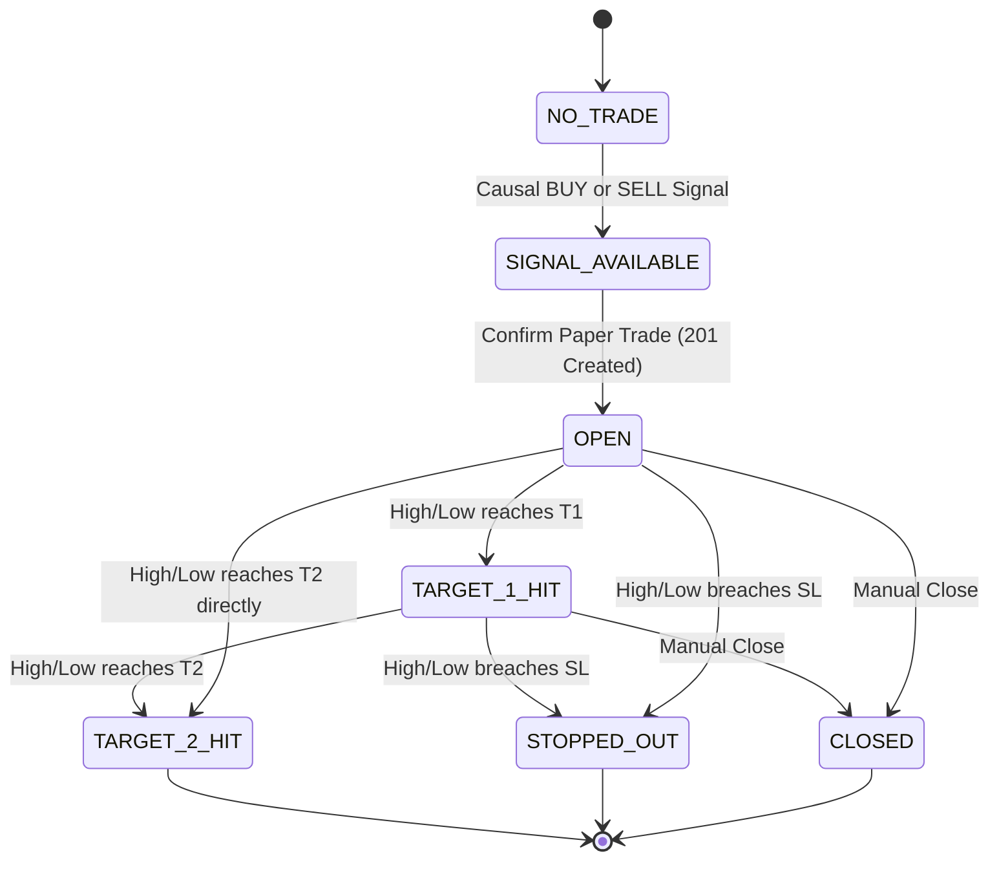

# SignalForge Phase 17 — Paper Trading Engine & Signal Lifecycle Report

## 1. Executive Summary

Phase 17 delivers a fully deterministic, causal Paper Trading Engine integrated directly with the SignalForge Strategy Signal Engine and interactive frontend dashboard. The engine enables users to initiate simulated paper trades directly from active algorithmic signals (`BUY` or `SELL`), track live unrealized P&L against market candles, monitor stop loss and dual execution targets, execute manual position closes, and maintain an immutable historical trade audit log.

Zero mock signals, zero fake prices, and zero imaginary slippage models are used. All state transitions, execution calculations, and exit resolutions operate under strict causal and conservative principles.

---

## 2. Existing Paper-Trading Architecture & Phase 17 Integration

### Existing Architecture (Pre-Phase 17)
- Backtest/Replay runner (`PaperTradingRunner` and `PaperTradingReplayRunner` in `src/paper_trading/`) operating offline across historical batch datasets.
- Session endpoints: `/api/paper-trading/status`, `/api/paper-trading/report`, `/api/paper-trading/start`, `/api/paper-trading/reset`.
- Read-only historical trade list representing replay outputs.

### Phase 17 Interactive Components
- **Interactive Engine Service (`src/paper_trading/interactive_engine.py`)**:
  - Manages discrete live simulated paper trades (`InteractivePaperTrade`).
  - Implements thread-safe in-memory caching backed by atomic JSON persistence (`data/paper_trading/interactive_trades.json`).
  - Enforces strict lifecycle state machines (`PENDING` → `OPEN` → `TARGET_1_HIT` | `TARGET_2_HIT` | `STOPPED_OUT` | `CLOSED` | `CANCELLED`).
  - Guards against duplicate active positions for identical symbol/timeframe pairs (`HTTP 409 Conflict`).
  - Validates bracket geometry (`LONG: sl < entry < t1 <= t2`, `SHORT: sl > entry > t1 >= t2`).
- **REST API Extensions (`src/api/routes/paper_trading.py`)**:
  - `POST /api/paper-trading/trades`: Open paper trade from valid strategy signal (returns `201 Created`).
  - `GET /api/paper-trading/trades`: Filterable trade history (`symbol`, `side`, `timeframe`, `status`).
  - `GET /api/paper-trading/trades/{trade_id}`: Single trade lookup.
  - `GET /api/paper-trading/open`: Live query for active positions (`OPEN`, `TARGET_1_HIT`).
  - `POST /api/paper-trading/trades/{trade_id}/update`: Candle/price evaluation with conservative exit logic.
  - `POST /api/paper-trading/trades/{trade_id}/close`: Discretionary manual exit.
  - `GET /api/paper-trading/summary`: Aggregate metrics (win rate, gross P&L, average trade, best/worst trade).
- **Frontend Dashboard Integration**:
  - `StrategySignalPanel.jsx`: Live paper trade trigger button, confirmation modal with explicit warnings, and active trade monitoring card.
  - `PaperTradingView.jsx`: Performance summary cards, active positions table with live close buttons, and filtered historical trade ledger.
  - `api.js`: Strongly-typed API client wrapper functions.

---

## 3. Trade Lifecycle State Machine

Deterministic state transitions prevent state corruption:

### Invalid State Transitions (Strictly Rejected)
- `CLOSED` → `OPEN` (Rejected: HTTP 400 Bad Request)
- `STOPPED_OUT` → `OPEN` (Rejected: HTTP 400 Bad Request)
- `TARGET_2_HIT` → `OPEN` (Rejected: HTTP 400 Bad Request)
- `CANCELLED` → `OPEN` (Rejected: HTTP 400 Bad Request)
- Updating or closing any terminal trade (Rejected: HTTP 400 Bad Request)

---

## 4. P&L Engine Formulas

All P&L figures are deterministic and explicitly designated as **GROSS P&L** without fabricated broker commissions or hidden slippage assumptions:

### LONG Positions
- **Realized P&L**:
  $$\text{Realized P\&L} = (\text{exit\_price} - \text{entry\_price}) \times \text{quantity}$$
- **Unrealized P&L**:
  $$\text{Unrealized P\&L} = (\text{current\_price} - \text{entry\_price}) \times \text{quantity}$$

### SHORT Positions
- **Realized P&L**:
  $$\text{Realized P\&L} = (\text{entry\_price} - \text{exit\_price}) \times \text{quantity}$$
- **Unrealized P&L**:
  $$\text{Unrealized P\&L} = (\text{entry\_price} - \text{current\_price}) \times \text{quantity}$$

---

## 5. Exit Rules & Ambiguous Candle Resolution

When evaluating an open trade against an incoming market candle:
- **LONG Stop Condition**: `candle.low <= stop_loss`
- **LONG Target 1 Condition**: `candle.high >= target_1`
- **LONG Target 2 Condition**: `candle.high >= target_2`
- **SHORT Stop Condition**: `candle.high >= stop_loss`
- **SHORT Target 1 Condition**: `candle.low <= target_1`
- **SHORT Target 2 Condition**: `candle.low <= target_2`

### Ambiguity Resolution (Conservative Rule)
If a high-volatility bar satisfies **both** the stop loss condition and a target condition within the same candle (`low <= SL` and `high >= T1`), the data stream cannot prove tick ordering without sub-second order book data.
- **Rule**: Never assume the favorable outcome. The engine deterministically triggers **STOP LOSS FIRST** (`STOPPED_OUT`).
- **Exit Price**: Evaluated at `stop_loss`.
- **Exit Reason**: `"Stop Loss Hit (Conservative Resolution)"`.

---

## 6. Risk Guards & Entry Validation

The paper trading engine enforces the following guards before accepting any trade:
1. **Valid Signal Required**: Rejects any attempt to open a trade from `NO_TRADE` with HTTP 400.
2. **Side Direction Matching**: Rejects attempts to open SHORT from a BUY signal or LONG from a SELL signal.
3. **Symbol & Timeframe Constraints**: Rejects empty symbols; restricts execution strictly to supported causal intervals (`5m`, `10m`, `15m`, `30m`). Rejects unsupported timeframes (`1H`, `4H`, `1D`).
4. **Bracket Geometry**:
   - For LONG: `stop_loss < entry_price`, `target_1 > entry_price`, `target_2 >= target_1`.
   - For SHORT: `stop_loss > entry_price`, `target_1 < entry_price`, `target_2 <= target_1`.
5. **Numeric Rigor**: Rejects zero, negative, `NaN`, or infinite values for prices and quantities (`quantity >= 1`, integer only).
6. **Duplicate Position Protection**: Queries active positions for the same `(symbol, timeframe)`. If an active position exists, returns `HTTP 409 Conflict`.
7. **Simulated Labeling**: All UI components explicitly display `SIMULATED • NO REAL ORDER` to prevent user confusion with live broker execution.

---

## 7. No Look-Ahead Audit

Strict causality is guaranteed across entry and exit lifecycles:
1. **Entry Causality**: Trade entry uses only the timestamp and prices available at signal confirmation time.
2. **Exit Causality**: Exit evaluations reject any candle or tick with `timestamp < entry_timestamp` (`Look-ahead violation: Evaluation timestamp cannot be earlier than entry timestamp`).
3. **Target Transparency**: Targets are never retroactively backfilled or displayed prior to the candle that actually reached the level.

---

## 8. Persistence Approach

Interactive paper trades are serialized to `data/paper_trading/interactive_trades.json` upon every state mutation (create, update, close, reset).
- Survives FastAPI reload and process restarts.
- Auto-creates parent directories if absent.
- Full reset (`POST /api/paper-trading/reset`) clears both session replay and interactive persistent stores.

---

## 9. Verification & Test Results

### Backend Test Results (pytest)
- **Suite**: `tests/api/test_phase17_paper_trading.py` (21 tests) + `test_paper_trading_api.py` (5 tests) + Core APIs (26 tests) = **52 passed**.
- All 20 required Phase 17 scenarios verified:
  1. Valid LONG creation: PASS
  2. Valid SHORT creation: PASS
  3. Reject NO_TRADE: PASS
  4. Reject invalid LONG stop: PASS
  5. Reject invalid SHORT stop: PASS
  6. Reject duplicate active position (409): PASS
  7. Update open trade & unrealized P&L: PASS
  8. Stop-loss exit: PASS
  9. Target exit: PASS
  10. Manual close: PASS
  11. Correct LONG Gross P&L: PASS
  12. Correct SHORT Gross P&L: PASS
  13. Unrealized P&L calculation: PASS
  14. Invalid state transition rejection: PASS
  15. Missing symbol rejection: PASS
  16. Invalid timeframe rejection: PASS
  17. Invalid quantity rejection: PASS
  18. Missing required prices rejection: PASS
  19. Deterministic OHLC ambiguity (conservative stop-first): PASS
  20. No look-ahead audit: PASS
  21. Summary metrics aggregation: PASS

### Frontend Test Results (vite-node)
- **Total Frontend Suites**: 11 suites.
- **Total Frontend Tests**: **163 passed / 0 failed**.
- New Phase 17 suite (`frontend/test/paper_trading_phase17.test.js`): 10/10 PASS.

---

## 10. Known Limitations

1. **Broker Integration**: Real money broker execution (Groww, Zerodha, Delta Exchange) is intentionally excluded in Phase 17.
2. **Gross P&L Only**: P&L is calculated gross. Exchange transaction fees, STT, and slippage are not deducted until a dedicated exchange execution phase is introduced.
3. **Intra-bar Tick Ordering**: Without sub-second tick feeds, ambiguous intra-bar high/low touches are resolved conservatively as stop-loss triggers.
