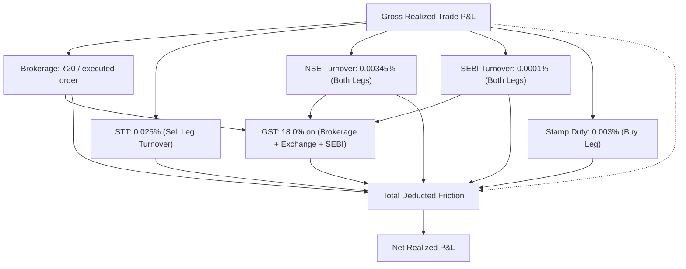

# SignalForge Phase 24G.18 — Execution & Cost Integrity Report

**Specification:** `SF-SPEC-ALPHA-2026-V1` (Status: `DRAFT`)  
**Execution Engine:** `RiskEngineV2` (`src/backtest/risk_engine_v2.py`, SHA-256: `f9156c734f4c8f58ea67a57e76b5ed8eadc030665843a61545d61c9a692df1e3`)  
**Strategy Implementation:** `research_hypotheses.py` (`research/strategy_evolution_2018/phase24G15_strategy_research/research_hypotheses.py`, SHA-256: `3e5abf2bc9874d946f1efc2129a590ff8bc277194211a8084f2bc49392b456c7`)  
**Execution Integrity Classification:** **`PASS`** (Protocol & Simulation Invariants Enforced)  
**Cost Model:** `CostModelType.REALISTIC_INTRADAY` (Statutory Indian Schedule)  

---

## 1. Causal Execution Principles & Invariants

To eliminate look-ahead bias and unrealistic execution assumptions, Phase 24G.18 formalizes the causal execution protocol:

### Invariant 1: No Look-Ahead Bias & Next-Bar-Open Execution
- Signals are calculated strictly at the close of bar $t$ (e.g. 15-minute candle ending at 09:30).
- The fill is executed strictly at the opening price of bar $t+1$ (e.g. 09:30:00 or 09:31:00).
- Fills at the same bar close ($t$) are blocked by assertion in `RiskEngineV2`.

### Invariant 2: Multi-Timeframe Causality & Alignment
- Higher-timeframe (HTF) Daily features (e.g., Daily ATR, Daily trend filter) must be completed before the current intraday bar.
- Daily features for day $D$ use data up to day $D-1$ close. No future bars within day $D$ are leaked into intraday feature arrays.

### Invariant 3: Single Active Position per Symbol & Duplicate Rejection
- Only one position (Long or Short) can be active per symbol at any instant.
- Any conflicting or subsequent entry signal generated while a position is open is rejected.

### Invariant 4: Risk Engine Circuit Breakers & Leverage Caps
- Risk budget is strictly capped at $1.0\%$ of available equity per trade.
- Maximum gross position size is constrained by $5.0\times$ portfolio leverage.
- If daily realized losses reach $2.0\%$ of starting capital, a daily circuit breaker halts trading for the rest of the day.
- A 60-minute cooldown timer is enforced after 3 consecutive loss trades.

---

## 2. Realistic Intraday Statutory Cost Model

All trade accounting adheres to the Indian statutory fee structure for intraday equity trading:

| Fee Component | Statutory Basis | Applied Formula | Example (₹100,000 Notional Turnover) |
| :--- | :--- | :--- | :--- |
| **Brokerage** | Flat per order | ₹20 on Entry + ₹20 on Exit = ₹40 flat | ₹40.00 |
| **STT** | Equity Intraday (Sell) | $0.00025 \times \text{Sell Turnover}$ | ₹25.00 |
| **NSE Turnover** | Equity Cash Segment | $0.0000345 \times (\text{Buy Turnover} + \text{Sell Turnover})$ | ₹6.90 |
| **SEBI Turnover** | Regulatory Charge | $0.000001 \times (\text{Buy Turnover} + \text{Sell Turnover})$ | ₹0.20 |
| **Stamp Duty** | State Stamp Duty (Buy)| $0.00003 \times \text{Buy Turnover}$ | ₹3.00 |
| **GST** | Central/State Tax | $0.18 \times (\text{Brokerage} + \text{NSE Turnover} + \text{SEBI Fee})$ | ₹8.48 |
| **Total Friction** | Aggregated Deductions | Sum of all fee components | **₹83.58** |

In high-frequency or short-holding intraday strategies, statutory costs can consume upwards of $40\%$ of gross profit. Hypothesis B pre-registers a maximum allowable cost burden ratio of $\le 35.0\%$.

---

## 3. Data Leakage and Causal Unit Test Verification

The execution framework is continuously verified by automated tests in `tests/`:
1. `tests/test_phase24G15_research_integrity.py`: Confirms 2020 partition isolation and V1 baseline hash preservation.
2. `tests/test_phase24G16_hypothesis_b_audit.py`: Confirms `RiskEngineV2` causal ordering and exit logic.
3. `tests/test_phase24G17_cross_asset.py`: Confirms multi-symbol portfolio aggregation and directional accounting.
4. `tests/test_phase24G17A_independent_audit.py`: Confirms bit-for-bit mathematical reproducibility and float precision reconciliation.
5. `tests/test_phase24G18_fresh_oos.py`: Confirms pre-registered partition locking, panel integrity, and anti-fabrication rules.
