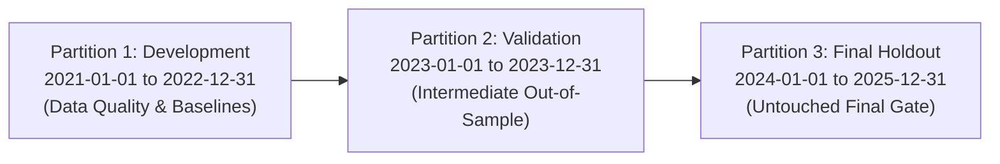

# SignalForge Phase 24G.18 — Pre-Registration Protocol
## Pre-Registered Fresh Out-of-Sample Generalization Research

**Document ID:** `SF-PHASE24G18-PREREG-2026-V1`  
**Specification Reference:** `SF-SPEC-ALPHA-2026-V1`  
**Current Specification Status:** `DRAFT`  
**Candidate Strategy:** Hypothesis B — Multi-Timeframe Volatility Compression & Breakout (`HYP_B_BASE`)  
**Current Classification:** `PROMISING_RESEARCH_CANDIDATE`  
**Trading Authorization:** `NONE` (Zero Live, Zero Paper, Historical Simulator Only)  
**Parent Strategy Baseline:** SignalForge V1 (Frozen Hash: `920515d71ebb2cea693193897103d19c1ec35c5013b85715dc209b64a45e4ec7`)  
**Canonical ADANIPORTS Hash:** `fb3275527303879c5edd26bcff08ba6a9a41c5de85f5acc6ead21b01fce26cf9`  
**2020 Partition Status:** `EXPLORATORY / CONTAMINATED` (Quarantined, Zero Access)  
**Timestamp of Pre-Registration:** `2026-11-03T15:15:00+05:30`  

---

## 1. Executive Summary & Research Objectives

Phase 24G.18 establishes a formal pre-registered scientific protocol to evaluate whether Hypothesis B (`HYP_B_BASE`) exhibits genuine out-of-sample temporal and cross-sectional generalizability beyond its historical discovery universe (`ADANIPORTS`, `RELIANCE`, `INFY`, `ICICIBANK`) and beyond its historical development period (2017–2018 Training, 2019 Validation).

The objective of this phase is strictly to test the hypothesis of generalizability under un-optimized, frozen conditions, **not** to tune parameters, maximize historical returns, or curve-fit alternative indicator settings.

### Core Governance Constraints
1. **Frozen Candidate Invariant**: Strategy parameters, indicators, and risk-management rules are frozen bit-for-bit to their audited Phase 24G.17A definitions. No parameter adjustment is permitted.
2. **2020 Holdout Quarantine**: The 2020 historical period remains classified as `EXPLORATORY / CONTAMINATED` and is strictly quarantined with zero access.
3. **Partition Isolation**: The post-2020 target research window is partitioned into Development (2021–2022), Validation (2023), and Final Untouched Holdout (2024–2025). The Final Holdout remains cryptographically and procedurally locked.
4. **Data Honesty & Anti-Fabrication Rule**: Under no circumstances shall synthetic, interpolated, or fabricated data be used. If physical data is absent on disk for any symbol or partition, it must be explicitly recorded as `NOT_TESTED` / `DATA_UNAVAILABLE_ON_DISK`.
5. **No Trading Authorization**: All work is restricted to offline simulation. Active paper ledgers (`data/paper_trading/interactive_trades.json`) and universe registry (`data/universe_registry.json`) are protected by hash invariants.

---

## 2. Frozen Candidate Specification Snapshot

The strategy configuration is extracted and frozen in [`phase24G18_candidate_snapshot.json`](file:///c:/Study%20Roadmap/PROJECTS/SignalForge/research/strategy_evolution_2018/phase24G18_fresh_oos/phase24G18_candidate_snapshot.json) (Config SHA-256: `1ff9099cd8184e14a37c9ba46e593ba9deac581d1c3e6548c05a03a269dedb1e`).

| Configuration Element | Specification Parameter | Pre-Registered Value | Justification / Source |
| :--- | :--- | :--- | :--- |
| **Strategy Family** | `hypothesis_family` | `VOLATILITY_BREAKOUT` | Phase 24G.15 Specification |
| **Primary Timeframe** | Intraday Execution Bar | 15-Minute Resampled | Phase 24G.15 Baseline |
| **Breakout Lookback** | `donchian_period` | 20 bars | Upper/Lower channel breakout |
| **Volume Compression** | `rvol_threshold` | 1.5 | Multi-timeframe relative volume |
| **Squeeze Condition** | `strict_squeeze` | `False` | Audited Phase 24G.16/17 setting |
| **Cooldown Period** | `cooldown_minutes` | 0 | Unrestricted signal generation |
| **Initial Capital** | `initial_capital` | ₹100,000.00 | Standard simulator account equity |
| **Risk Budget per Trade** | `risk_per_trade` | 1.0% (₹1,000.00 initial) | RiskEngineV2 specification |
| **Max Portfolio Leverage** | `max_leverage` | 5.0x | SEBI Intraday MIS Margin Limit |
| **Dynamic Stop Loss** | `k_stop` | $1.5 \times \text{ATR}_{14}$ | Causal trailing / stop bracket |
| **Dynamic Take Profit** | `k_target` | $3.0 \times \text{ATR}_{14}$ | 1:2 Risk-to-Reward minimum ratio |
| **Execution Model** | `execution_model` | `next_open` | Causal bar-open execution (no close fill) |
| **Cost Model** | `cost_model` | `REALISTIC_INTRADAY` | Statutory Indian tax & broker schedule |
| **Intraday Brokerage** | `brokerage_per_order` | ₹20.00 flat per executed leg | Standard discount broker fee |
| **Securities Transaction Tax**| `stt_sell_rate` | 0.025% on sell turnover | Indian Finance Act schedule |
| **NSE Turnover Charges** | `nse_turnover_rate` | 0.00345% turnover | Exchange tariff |
| **GST** | `gst_rate` | 18.0% on (Brokerage + Turnover) | Statutory tax |
| **Stamp Duty** | `stamp_duty_buy_rate` | 0.003% on buy turnover | State stamp duty |
| **SEBI Turnover Fee** | `sebi_turnover_rate` | 0.0001% (₹10/crore) | Regulator levy |

---

## 3. Pre-Registered Chronological Partitions

To protect against sequential data snooping, the target 2021–2025 out-of-sample horizon is partitioned chronologically:

1. **Partition 1 (Development & Data Quality)**:
   - Start: `2021-01-01 09:15:00`
   - End: `2022-12-31 15:29:00`
   - Purpose: Assessment of post-COVID volatility regimes, liquidity shifts, and structural data availability.
2. **Partition 2 (Validation)**:
   - Start: `2023-01-01 09:15:00`
   - End: `2023-12-31 15:29:00`
   - Purpose: Validation of strategy parameters under higher interest rates and mature algorithmic liquidity.
3. **Partition 3 (Final Untouched Holdout)**:
   - Start: `2024-01-01 09:15:00`
   - End: `2025-12-31 15:29:00`
   - Purpose: Final unbiased verification. Locked until Partitions 1 and 2 are fully audited.

---

## 4. Pre-Registered Universe Design (22 Equities across 8 Sectors)

The evaluation panel is constructed across 8 liquid sectors of the National Stock Exchange of India (NSE):

1. **Banking & Financial Services**: `HDFCBANK`, `ICICIBANK`, `SBIN`, `AXISBANK`, `BAJFINANCE`
2. **Information Technology**: `INFY`, `HCLTECH`, `COFORGE`
3. **Energy & Oil/Gas**: `RELIANCE`, `BPCL`, `ONGC`
4. **Automobiles & Auto Components**: `MARUTI`, `BAJAJ_AUTO`, `EICHERMOT`
5. **Metals & Mining**: `JSWSTEEL`, `SAIL`, `ADANIENT`
6. **Pharmaceuticals & Healthcare**: `SUNPHARMA`, `DRREDDY`
7. **Fast Moving Consumer Goods (FMCG)**: `ITC`, `BRITANNIA`
8. **Infrastructure & Services**: `ADANIPORTS`

### Pre-Registered Inclusion & Exclusion Criteria
- **Inclusion Criteria**: High market capitalization, presence in liquid intraday derivatives / cash segments, representative sector representation.
- **Exclusion Criteria**: Non-equities, penny stocks, stocks with trading suspensions $> 30$ continuous days, or instruments lacking causal timestamp order.
- **Data Availability Check**: If 1-minute historical data does not extend across the pre-registered partitions on disk, the symbol is recorded as `NOT_TESTED` / `DATA_UNAVAILABLE_ON_DISK` without synthetic interpolation.

---

## 5. Pre-Registered Decision Gates

The final research gate must assign one of the following mutually exclusive verdicts:

| Gate Decision | Criteria | Subsequent Action |
| :--- | :--- | :--- |
| `PREFLIGHT_BLOCKED` | Preflight hash mismatch, registry modification, or unauthorized ledger write | Halt all execution immediately |
| `DATA_QUALITY_FAILURE` | Missing data, incomplete bar coverage, or unavailable post-2020 files on disk | Document data boundaries, halt data evaluation |
| `EXECUTION_INTEGRITY_FAILURE`| Look-ahead leakage, close-to-close fill anomalies, or cost omission | Invalidate backtest engine results |
| `RESEARCH_INCONCLUSIVE` | Trade sample size insufficient ($N < 30$), statistical power inadequate ($p > 0.05$) | Retain candidate in DRAFT, recommend data ingestion |
| `GENERALIZATION_NOT_SUPPORTED` | Negative net P&L after friction, profit factor $< 1.0$, or systemic failure across sectors | Reject hypothesis, archive candidate |
| `PROMISING_OUT_OF_SAMPLE_EVIDENCE` | Positive net P&L across $> 75\%$ of sectors, PF $> 1.30$, statistically significant ($p < 0.05$) | Retain candidate in PROMISING_RESEARCH_CANDIDATE |

> [!IMPORTANT]
> A finding of `PROMISING_OUT_OF_SAMPLE_EVIDENCE` does **NOT** authorize live or paper trading. Deployment authorization requires explicit multi-agent risk governance sign-off and specification promotion from `DRAFT` to `APPROVED`.
