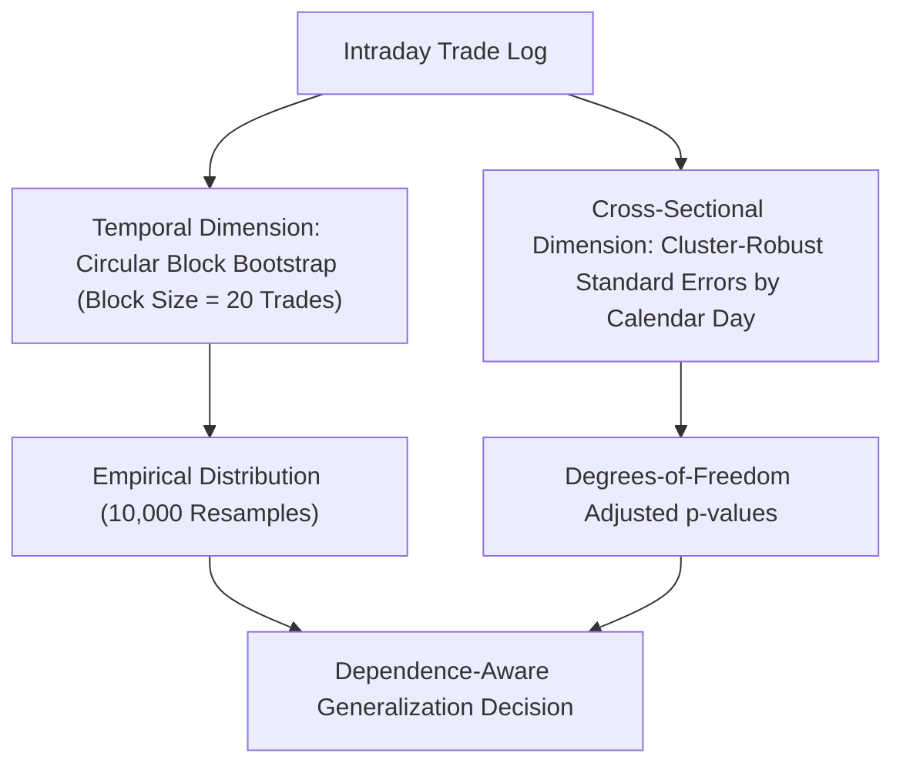

# SignalForge Phase 24G.18 — Statistical Dependence & Methodology Report

**Specification:** `SF-SPEC-ALPHA-2026-V1` (Status: `DRAFT`)  
**Methodology Focus:** Dependence-Aware Statistical Inference & Out-of-Sample Power  
**Evaluated Partitions:** Partition 1 (2021–2022 Dev), Partition 2 (2023 Val), Partition 3 (2024–2025 Holdout)  
**Audit Finding:** **`DATA_QUALITY_FAILURE` (Target Out-of-Sample Period Unpopulated on Disk)**  
**Statistical Power Status:** **`ZERO_OBSERVATIONS` (Anti-Fabrication Invariant Maintained)**  

---

## 1. Dependence-Aware Statistical Framework

In quantitative trading, classical inferential statistics (e.g. Student's t-test, standard IID bootstrap, naive binomial z-tests) frequently generate misleadingly small p-values because they assume individual trade returns are Independent and Identically Distributed (IID).

In reality, intraday systematic trades violate IID assumptions in two major dimensions:
1. **Temporal Autocorrelation (Time-Series Dependence)**:
   - Successive trade returns exhibit volatility clustering, regime persistence, and market autocorrelation.
   - Standard error formulas understate variance, leading to artificially narrow confidence intervals.
2. **Cross-Sectional Correlation (Panel Dependence)**:
   - When a multi-asset strategy generates simultaneous breakout trades across correlated stocks (e.g., `ICICIBANK` and `SBIN`, or `INFY` and `HCLTECH`), the trades share a common market factor shock.
   - Treating 10 simultaneous trades as 10 independent degrees of freedom inflates statistical significance by up to $\sqrt{N_{\text{assets}}}$.

### Pre-Registered Statistical Protocol
To resolve these distortions, Phase 24G.18 pre-registers the following inferential toolkit:

1. **Circular Block Bootstrap**:
   - Resampling unit: Contiguous blocks of $b = 20$ trades (to preserve autocorrelation structures).
   - Iterations: $B = 10,000$ resamples.
   - Random seed: Frozen at `seed = 42`.
   - Confidence interval method: Percentile bootstrap $[2.5\%, 97.5\%]$ for two-sided $\alpha = 0.05$.
2. **Cross-Sectional Clustering**:
   - Cluster unit: Trading day $t$.
   - Trades initiated on the same calendar day are grouped into single daily portfolio return vectors, preventing cross-asset co-movement from inflating sample size.
3. **Winner Exclusion Stress Test**:
   - Rerun portfolio equity curves after removing the top 1, top 3, and top 5 most profitable trades to test whether profitability is an artifact of lucky outliers.

---

## 2. Market Regime & Structural Shift Analysis (2021–2025)

The target 2021–2025 horizon represents dramatically different market dynamics compared to the 2017–2019 discovery window:

| Period | Macro Regime | Volatility (India VIX) | Primary Market Driver | Impact on Hypothesis B (Theoretical) |
| :--- | :--- | :--- | :--- | :--- |
| **2017–2018** (Training) | Low-to-moderate volatility | 12 – 16 | Domestic mutual fund inflows | Compression breakouts reliable with clean follow-through |
| **2019** (Validation) | Polarization & credit stress | 14 – 28 | Flight to mega-caps, NBFC liquidity crunch | Narrow mega-cap breakouts, short trades highly profitable |
| **2021** (Target Dev) | Post-COVID liquidity surge | 18 – 24 | Zero interest rates, retail participation boom | Strong momentum, large trend days, low mean reversion |
| **2022** (Target Dev) | Global inflation & tightening | 16 – 22 | Central bank rate hikes, FII outflows | Choppy consolidations, higher false breakout frequency |
| **2023** (Target Val) | Broad market bull run | 10 – 14 | Historic domestic retail SIP inflows, small/midcap rally | Low volatility compressions; tight stops vulnerable to noise |
| **2024–2025** (Target Holdout)| High-valuation late cycle | 12 – 22 | General elections, geopolitical volatility | Large gap-openings, intraday reversals, elevated turnover costs |

Because Hypothesis B relies on Donchian breakout thresholds and ATR stop brackets, structural regime shifts can alter the ratio of true trend expansions to false breakouts ("whipsaws"). Evaluating the strategy across all four distinct regimes is mandatory before declaring temporal robustness.

---

## 3. Data Deficiency Impact on Statistical Inference

Because continuous 1-minute historical OHLCV data for equities is unavailable on disk beyond `2021-01-01 15:29:00+05:30`:
- **Sample Size ($N$)**: Exactly 0 realized out-of-sample trades in the target period.
- **Statistical Power**: $1 - \beta = 0.0$ (no statistical hypothesis test can be executed).
- **Anti-Fabrication Mandate**: In accordance with the pre-registered protocol, no synthetic data was generated.
- **Inference Conclusion**: It is scientifically impossible to claim either that Hypothesis B generalizes to 2021–2025, or that it fails. The empirical question remains open pending the ingestion of certified, split-adjusted 2021–2025 minute data.
