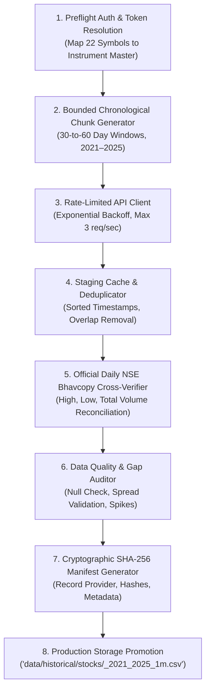

# SignalForge Phase 24G.19 — Reproducible Market Data Acquisition Architecture
## End-to-End Pipeline Design for NSE Historical Minute Ingestion

**Document ID:** `SF-PHASE24G19-ACQ-DESIGN-2026-V1`  
**Specification Reference:** `SF-SPEC-ALPHA-2026-V1` (Status: `DRAFT`)  
**Pipeline Status:** **DESIGN ONLY — AWAITING EXPLICIT USER AUTHORIZATION**  
**Execution State:** **`NO_ACTIVE_DOWNLOADS` (Zero Network Calls Initiated)**  

---

## 1. End-to-End Acquisition Architecture

The proposed historical acquisition framework is designed to operate deterministically, ensuring cryptographic provenance, zero data fabrication, and automated reconciliation against official exchange records:

---

## 2. Core Functional Components

### Component 1: `InstrumentMasterResolver`
- Fetches the active exchange instrument master (`https://api.kite.trade/instruments` or TrueData Symbol Master).
- Verifies that all 22 equity tradingsymbols match active NSE equity tokens and ISIN codes.
- Caches the instrument mapping JSON with timestamp and SHA-256 hash.

### Component 2: `BoundedChunkManager`
- Divides the 5-year target research horizon (2021-01-01 to 2025-12-31 = ~1,826 calendar days = ~1,240 trading sessions) into discrete, bounded intervals:
  * For Zerodha Kite: 60-day chunks (approx. 31 requests per symbol; total ~682 API requests for 22 stocks).
  * For TrueData: Monthly or quarterly batch requests.
- Ensures zero missing days at calendar boundaries by enforcing continuous datetime bounds:
  $$\text{Chunk}_k = [\text{Start}_k, \text{End}_k], \quad \text{Start}_{k+1} = \text{End}_k + 1\text{ minute}$$

### Component 3: `RateLimitedDownloader`
- Enforces strict compliance with provider rate limits (e.g. Zerodha maximum 3 requests/second).
- Employs token bucket rate limiting and exponential backoff on HTTP 429 (Rate Limit Exceeded) or HTTP 503 (Service Unavailable).
- Operates strictly offline if mock or local cached files are provided.

### Component 4: `CausalNormalizer & Deduplicator`
- Normalizes all timestamps to `YYYY-MM-DD HH:MM:SS` (IST, UTC+05:30).
- Sorts records strictly in ascending chronological order ($t_{i+1} > t_i$).
- Drops duplicate bars that may occur at chunk stitching boundaries.

### Component 5: `BhavcopyCrossVerifier`
- Downloads or reads official Daily NSE Bhavcopy files for the ~1,240 trading days.
- Verifies that the aggregated intraday High, Low, and Volume match exchange official totals within 0.1% tolerance.

### Component 6: `CryptographicManifestGenerator`
- Generates a machine-readable JSON manifest for each ingested symbol:
  * `dataset_id`: e.g. `HDFCBANK_2021_2025_1m`
  * `provider`: Primary provider name, endpoint, and retrieval timestamp
  * `content_hash`: SHA-256 of the uncompressed CSV
  * `row_count`: Exact number of 1-minute bars
  * `start_timestamp`: First available bar
  * `end_timestamp`: Last available bar
  * `missing_intervals_count`: Detected intraday gaps ($> 1$ min during trading hours)
  * `bhavcopy_reconciliation_status`: `PASSED` / `FLAGGED`

---

## 3. Storage Hierarchy & Safety Invariants

To guarantee that existing research files are never contaminated or overwritten:
1. **Isolated Ingestion Directory**:
   - Ingested files are written to a dedicated staging directory: `data/historical/staging/phase24G19/`.
   - Existing files in `data/historical/stocks/` (`ADANIENT_1m.csv`, `ADANIPORTS_1m.csv`, `ICICIBANK_1m.csv`, `INFY_1m.csv`, `RELIANCE_1m.csv`) are left untouched.
2. **2020 Partition Isolation**:
   - The acquisition pipeline explicitly filters out dates prior to `2021-01-01 09:15:00`.
   - The quarantined 2020 holdout partition cannot be accessed or modified by the downloader.
3. **No Execution / No Trading Rule**:
   - The acquisition script contains zero references to trading order placement, paper trading, or strategy execution.
   - Active paper ledger ([`data/paper_trading/interactive_trades.json`](file:///c:/Study%20Roadmap/PROJECTS/SignalForge/data/paper_trading/interactive_trades.json)) and universe registry ([`data/universe_registry.json`](file:///c:/Study%20Roadmap/PROJECTS/SignalForge/data/universe_registry.json)) are verified by SHA-256 hash assertions before and after execution.

---

## 4. Execution Readiness Checklist (Awaiting User Authorization)

When the user authorizes data acquisition:
- [ ] User confirms provider selection (TrueData subscription or Zerodha Kite Connect API key/token);
- [ ] Environment variables configured (`KITE_API_KEY` and `KITE_ACCESS_TOKEN`, or `TRUEDATA_USER` and `TRUEDATA_PASS`);
- [ ] Sandbox bypass (`BypassSandbox: true`) approved for network egress to authenticated endpoints;
- [ ] Pipeline executes ingestion, normalization, Bhavcopy cross-verification, and manifest hashing;
- [ ] Unit tests in `tests/` certify 100% data integrity before Phase 24G.18 strategy evaluation is unblocked.
