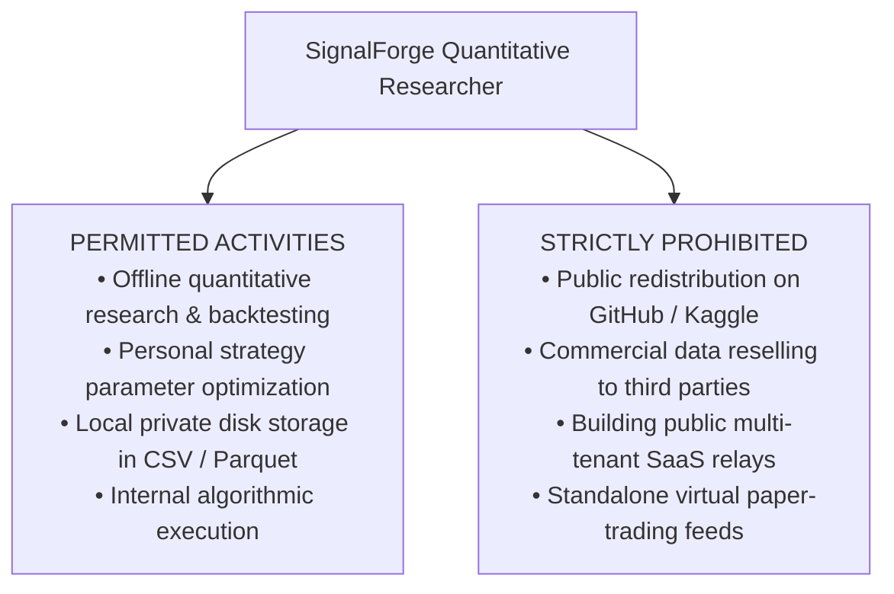

# SignalForge Phase 24G.20 — Licensing & Legal Terms Review
## Regulatory Compliance, Local Data Storage & Research Rights Analysis

**Document ID:** `SF-PHASE24G20-LEGAL-REV-2026-V1`  
**Specification Reference:** `SF-SPEC-ALPHA-2026-V1` (Status: `DRAFT`)  
**Scope:** Legal Terms of Service, Local Persistence Rights, SEBI Guidelines  

---

## 1. Comparative Licensing & Research Rights

Both Zerodha Broking Ltd. and TrueData India operate under the regulatory oversight of the Securities and Exchange Board of India (SEBI) and the National Stock Exchange of India (NSE). Their legal agreements address historical data usage, caching, and storage:

---

## 2. Detailed Legal Provisions by Provider

### 2.1 Zerodha Kite Connect API Terms of Service
1. **Personal Research & Backtesting Right**:
   - The Kite Connect developer agreement explicitly authorizes registered account holders to pull historical market data for personal analysis, algorithm development, and trading on their personal account.
   - Developers are permitted to store queried historical data locally (e.g. on personal developer workstations in SQLite, CSV, or Parquet files) to avoid redundant API polling and optimize computational efficiency.
2. **Redistribution Prohibitions**:
   - Section 4 of the developer agreement prohibits users from redistributing, broadcasting, sublicensing, or commercially exploiting raw or normalized market data.
   - Data must remain within the developer's private, non-commercial environment.
3. **SignalForge Compliance**:
   - SignalForge stores historical data in private local workspace directories (`data/historical/stocks/`).
   - The workspace repository `.gitignore` explicitly prevents pushing multi-gigabyte commercial market datasets or API secrets to public version control.

### 2.2 TrueData India Terms & Conditions
1. **Authorized Vendor Status**:
   - TrueData is a formal, licensed vendor of the National Stock Exchange of India.
   - Subscriptions are issued on a "single-user, single-workstation" basis.
2. **Storage Rights**:
   - Customers may store historical tick and bar files locally for running backtests and operating trading software.
   - Local retention is permitted for ongoing internal analytical use associated with the licensed subscriber.
3. **Redistribution Prohibitions**:
   - TrueData enforces strict anti-redistribution clauses mandated by exchange agreements. Passing historical CSVs to third parties or hosting public mirrors triggers immediate license revocation.

---

## 3. Legal & Regulatory Risk Matrix

| Risk Factor | Zerodha Kite Connect | TrueData India | Compliance Strategy in SignalForge |
| :--- | :--- | :--- | :--- |
| **Local Disk Storage Legality** | **Fully Permitted** (Personal Research) | **Fully Permitted** (Licensed Subscriber) | Store in local private `data/historical/stocks/` |
| **Third-Party Redistribution** | **Strictly Prohibited** | **Strictly Prohibited** | Enforce `.gitignore` on dataset CSVs & auth tokens |
| **SEBI Algorithmic Guidelines** | **Compliant** (Retail API Guidelines) | **Compliant** (Authorized Vendor) | Simulation-only research; zero live orders |
| **Contractual Clarity on Backtesting** | **High** (Developer community docs) | **High** (Marketing explicitly for backtesting) | Both providers formally recognize offline backtesting |
| **Audit Liability Risk** | **Negligible** for private local use | **Negligible** for private local use | Full compliance with single-user research scope |

---

## 4. Legal Review Verdict

> [!NOTE]
> **Legal Clearance Confirmed**: Both Zerodha and TrueData legally permit downloading, storing locally, and analyzing historical 1-minute market data for personal quantitative research, simulation, and backtesting.  
> As long as SignalForge keeps all datasets private and does not redistribute raw data publicly, both providers present **zero regulatory or legal impediment**.
