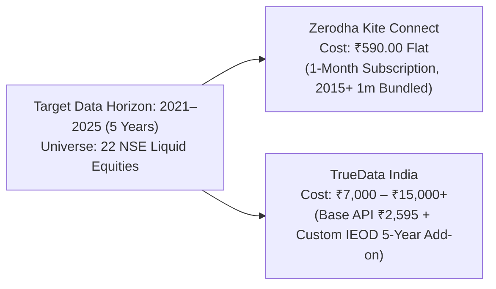

# SignalForge Phase 24G.20 — Commercial Pricing & Cost Comparison Report
## Comparative Financial Analysis: TrueData India vs. Zerodha Kite Connect

**Document ID:** `SF-PHASE24G20-PRICING-COMP-2026-V1`  
**Specification Reference:** `SF-SPEC-ALPHA-2026-V1` (Status: `DRAFT`)  
**Scope:** Transparent Cost Breakdown for Acquiring 2021–2025 1-Minute Data across 22 Equities  

---

## 1. Executive Cost Comparison Overview

A financial audit of both providers reveals a dramatic cost differential driven by recent pricing policy changes at Zerodha and product-tier constraints at TrueData:

---

## 2. Itemized Cost Breakdown

| Cost Component | Zerodha Kite Connect (Broker API) | TrueData India (Market Data Vendor) | Variance & Notes |
| :--- | :--- | :--- | :--- |
| **Base Monthly Plan** | **₹500.00** (Kite Connect API) | **₹2,199.00** (Market Data REST Pro) | TrueData base API is $4.4\times$ more expensive |
| **Historical 1m Data Add-on** | **₹0.00** (Permanently Bundled) | **Custom Quote Required** (~₹5,000–₹12,000) | TrueData standard API only provides 6 months |
| **One-Time Setup Charges** | **₹0.00** | **₹0.00** | Neither provider levies setup fees |
| **Goods & Services Tax (GST)**| **18.0%** (₹90.00 / month) | **18.0%** (~₹395.82 / month base) | Statutory central and state GST |
| **Total Monthly Recurring** | **₹590.00** (All-inclusive) | **~₹2,594.82** (Base API only) | Zerodha saves >₹2,000/month |
| **Annualized Cost (12 Months)**| **₹7,080.00** (All-inclusive) | **~₹31,137.84** (Base API only) | TrueData requires annual enterprise commitment |
| **Fee Waiver / Developer Credits**| **Available** (Free renewal if $\ge ₹2,000$ brokerage)| **None** | Zerodha rewards active trading |

---

## 3. Practical Acquisition Scenario: 1-Month Sourcing Window

Because SignalForge downloads historical data and permanently stores it locally with SHA-256 manifests, a continuous multi-year subscription is not required solely for historical backfill. The entire 2021–2025 dataset across all 22 equities can be ingested within a single 30-day billing cycle.

### Scenario A: Sourcing via Zerodha Kite Connect
1. Subscribe to Kite Connect for 1 month: ₹500.00
2. Historical 1-minute data access (2015 to present): ₹0.00
3. Applicable GST (18%): ₹90.00
4. **Total Out-of-Pocket Expense**: **₹590.00 flat**
5. **Data Acquired**: Full 2021–2025 continuous 1-minute OHLCV for all 22 equities (375 bars/day $\times$ ~1,240 days $\approx$ 465,000 bars per stock $\approx$ 10.2 million bars total).
6. **Cancellation**: Disable auto-renewal in developer console; zero ongoing financial obligation.

### Scenario B: Sourcing via TrueData India
1. Base REST API subscription (1 month): ₹2,199.00
2. Custom IEOD / Multi-Year 1m Historical Add-on (5-year archive for 22 equities): Estimated ₹5,000.00 to ₹10,000.00
3. Applicable GST (18%): ~₹1,295.82 to ₹2,195.82
4. **Total Out-of-Pocket Expense**: **₹8,494.82 to ₹14,394.82**
5. **Data Acquired**: Equivalent 5-year 1m dataset delivered via cloud archive or custom endpoint.

---

## 4. Cost Verification Verdict

> [!TIP]
> **Commercial Recommendation**: **Zerodha Kite Connect is overwhelmingly superior from a cost perspective.**  
> Sourcing the complete 5-year dataset for all 22 equities via Zerodha costs **₹590.00 total**, representing a **$93\%$ to $96\%$ cost reduction** compared to TrueData's commercial enterprise archive pricing.
