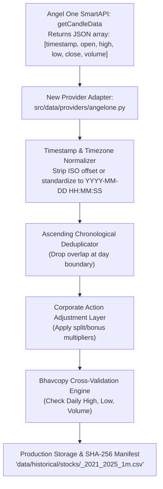

# SignalForge Phase 24G.22 — SignalForge Architecture & Codebase Compatibility
## Architectural Evaluation of Angel One SmartAPI Integration into SignalForge

**Document ID:** `SF-PHASE24G22-COMPAT-2026-V1`  
**Specification Reference:** `SF-SPEC-ALPHA-2026-V1` (Status: `DRAFT`)  
**Scope:** Ingestion Pipeline Analysis, Normalization Contracts & Manifest Verification  
**Status:** **FEASIBILITY AUDIT ONLY (NO DOWNLOADER IMPLEMENTATION OR EXECUTION)**  

---

## 1. Inspection of Existing Repository Architecture

SignalForge maintains a modular, decoupled data ingestion architecture located primarily in `src/data/`:

1. **Orchestrator Layer (`src/data/market_data_service.py`)**:
   - `MarketDataService`: Provider-agnostic coordinator enforcing strict provider selection, zero silent fallbacks, and validation against the canonical contract.
2. **Provider Interface (`src/data/market_data.py` and `src/data/providers/base.py`)**:
   - `MarketDataProvider`: Abstract base class requiring `is_available()`, `get_historical_data()`, and `get_realtime_data()`.
   - `CANONICAL_OHLCV_COLUMNS`: Standardized 6-column format `["timestamp", "open", "high", "low", "close", "volume"]`.
3. **Existing Provider Implementations**:
   - `LocalProvider` (`src/data/providers/local.py`): Ingests local CSV archives.
   - `GrowwProvider` (`src/data/providers/groww.py`): Implements chunked HTTP retrieval for Groww API.
   - `YFinanceProvider` (`src/data/providers/yfinance_provider.py`): Fallback provider.
4. **Standalone Scaffolding (`scripts/`)**:
   - `scripts/test_zerodha_historical_data.py`: Feasibility test for Zerodha Kite Connect.
   - `scripts/verify_historical_data.py` & `src/validation/data_quality.py`: Automated Bhavcopy cross-verification and gap auditing.

---

## 2. Compatibility Assessment for Angel One SmartAPI



### 2.1 Reusable vs. New Downloader Requirement
* **Finding**: SignalForge currently does **not** have an Angel One downloader in `src/data/providers/` or `scripts/`.
* **Action Required**: Integrating Angel One will require a dedicated adapter class: `AngelOneProvider` (`src/data/providers/angelone.py`) or a standalone extraction runner `scripts/download_angelone_historical.py`.
* **Implementation Simplicity**: Because `GrowwProvider` in `src/data/providers/groww.py` already implements multi-chunk date slicing and rate-limited HTTP requests via `httpx`, the Angel One adapter can cleanly reuse that exact architectural pattern.

### 2.2 Response Schema Accommodation
* **SmartAPI Response Schema**:
  ```json
  "data": [
    ["2023-09-06T09:15:00+05:30", 2450.5, 2458.0, 2449.0, 2455.0, 31250]
  ]
  ```
* **SignalForge Schema Fit**: **100% PERFECT FIT**. The array maps directly:
  - Index 0 $\to$ `timestamp`
  - Index 1 $\to$ `open`
  - Index 2 $\to$ `high`
  - Index 3 $\to$ `low`
  - Index 4 $\to$ `close`
  - Index 5 $\to$ `volume`
  No intermediate transformations or synthetic columns are required.

### 2.3 Timestamp & Session Normalization
* **Timestamp Representation**:
  - SmartAPI returns ISO 8601 strings with `+05:30` timezone suffixes (e.g., `2021-01-04T09:15:00+05:30`).
  - Standard SignalForge CSV convention in `data/historical/stocks/` stores timestamps as `YYYY-MM-DD HH:MM:SS` in `Asia/Kolkata` wall-clock time.
  - Normalization: The adapter will parse using `pd.to_datetime()` and format strings to `YYYY-MM-DD HH:MM:SS`.
* **Trading Session Bounds**:
  - Filter out any non-market bars outside `09:15:00` to `15:29:00` (e.g. pre-open or post-closing trade reports).

### 2.4 Duplicate Detection & Gap Analysis
* **Boundary Deduplication**: When stitching single-day responses, duplicate candles can occur if boundary timestamps overlap. An explicit deduplication step `df.drop_duplicates(subset=['timestamp'], keep='first')` followed by `df.sort_values('timestamp')` is mandatory.
* **Malformed OHLCV Sanitization**:
  - Check that $\text{High}_t \ge \max(\text{Open}_t, \text{Close}_t, \text{Low}_t)$.
  - Check that $\text{Low}_t \le \min(\text{Open}_t, \text{Close}_t, \text{High}_t)$.
  - Check that $\text{Volume}_t \ge 0$.
  - Any anomalous bar must be recorded in an anomaly register and quarantined.

### 2.5 Corporate-Action Back-Adjustment Layer
* **Critical Requirement**: Because SmartAPI returns **raw, unadjusted historical prices**, applying them directly to Hypothesis B would cause severe false breakout signals across major corporate actions:
  - `RELIANCE` (1:1 Bonus in Oct 2024 $\to 50\%$ nominal price drop);
  - `DRREDDY` (1:5 Split in Oct 2024 $\to 80\%$ nominal price drop);
  - `BPCL` (1:1 Bonus in June 2024 $\to 50\%$ nominal price drop).
* **SignalForge Adaptation**: The pipeline must store both:
  1. The raw ingested source files: `data/historical/raw/angelone/<SYM>_raw_1m.csv`.
  2. The split-adjusted research files: `data/historical/stocks/<SYM>_1m.csv` computed via an external corporate action adjustment table.

### 2.6 Cryptographic Manifest & Provenance Generation
* Each generated dataset must be accompanied by an official manifest (`data/historical/manifests/<SYM>_1m_manifest.json`):
  * `dataset_id`: e.g. `HDFCBANK_2021_2025_1m`
  * `provider`: `Angel One SmartAPI`
  * `content_hash`: SHA-256 of the normalized uncompressed CSV
  * `row_count`: Number of 1-minute bars
  * `null_count`: Total null observations (must be 0)
  * `bhavcopy_reconciliation_status`: `PASSED`
