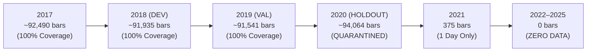

# Phase 24G.23 — Existing SignalForge Local Dataset Forensic Audit

**Project:** SignalForge  
**Phase:** 24G.23  
**Document ID:** SF-AUDIT-PHASE24G23-LOCAL-DATA-2026-V1  
**Scope:** Forensic Inspection of All On-Disk Historical Assets in `data/historical/`  
**Evaluation Mode:** STRICTLY OFFLINE (Read-Only Dataset Verification)  

---

## 1. Inventory of Existing Local Market Data Assets

SignalForge's local repository contains two categories of historical market data:
1. **Intraday Stock Equities (`data/historical/stocks/`):** 1-minute OHLCV candles for 5 select equities.
2. **Intraday Index Benchmarks (`data/historical/`):** 1-minute OHLC series for the NIFTY 50 Index.

### 1.1 Complete Local Asset Inventory

| File Path | Asset Type | File Size | Exact SHA-256 Hash | Manifest Status |
|:---|:---|:---:|:---|:---:|
| `data/historical/stocks/ADANIENT_1m.csv` | Equity 1m OHLCV | 19.94 MB | `885f9ebe49738b862bb36124975e88cd32d505836d371ed76841751fe10af1c4` | [`ADANIENT_1m_manifest.json`](file:///c:/Study%20Roadmap/PROJECTS/SignalForge/data/historical/manifests/ADANIENT_1m_manifest.json) |
| `data/historical/stocks/ADANIPORTS_1m.csv`| Equity 1m OHLCV | 19.97 MB | `fb3275527303879c5edd26bcff08ba6a9a41c5de85f5acc6ead21b01fce26cf9` | [`ADANIPORTS_1m_manifest.json`](file:///c:/Study%20Roadmap/PROJECTS/SignalForge/data/historical/manifests/ADANIPORTS_1m_manifest.json) |
| `data/historical/stocks/ICICIBANK_1m.csv` | Equity 1m OHLCV | 20.38 MB | `36eab7652ff59040564d91d723b8475a1761c4bfe325ded2758339ae0664196e` | [`ICICIBANK_1m_manifest.json`](file:///c:/Study%20Roadmap/PROJECTS/SignalForge/data/historical/manifests/ICICIBANK_1m_manifest.json) |
| `data/historical/stocks/INFY_1m.csv` | Equity 1m OHLCV | 20.39 MB | `41e1c679baf0dd08dd48a86ddbec9e7a2ea1e548a6fa0c663d12fad5a040fd55` | [`INFY_1m_manifest.json`](file:///c:/Study%20Roadmap/PROJECTS/SignalForge/data/historical/manifests/INFY_1m_manifest.json) |
| `data/historical/stocks/RELIANCE_1m.csv` | Equity 1m OHLCV | 21.15 MB | `a2dd7374b27045cddc2b528065d40007ca24ce131965636b9206a317d7c50260` | [`RELIANCE_1m_manifest.json`](file:///c:/Study%20Roadmap/PROJECTS/SignalForge/data/historical/manifests/RELIANCE_1m_manifest.json) |
| `data/historical/nifty50_1m.csv` | Index Benchmark | 476.18 KB | `8220f188360f06a0c5c363ea5d8c1c46399c51cb56c86e0c65ef6383633d9eb7` | Internal Validation Sample |
| `data/historical/nifty50_1m_research.csv` | Index Benchmark | 45.56 MB | `ad9a7ff953f93a9d949437435fce1ba6599db107fcfe5c2a30bb53127815aa0b` | Extended Index (No Volume) |
| `data/historical/nifty50_1m_signalforge.csv`| Index Benchmark | 48.95 MB | `c17febe06a6c0efb0e01ea313c004dbf556e431f13b63fa2382cf4f14120ecba` | Normalized Index Series |
| `data/historical/nifty50_github_1m.csv` | Index Benchmark | 51.31 MB | `bb56372bf941f1225fbbf98ea0573bead5424cf9633e9be64585e51080ee1104` | GitHub Open Data Dump |

---

## 2. Granular Per-Stock & Per-Year Coverage Analysis

An empirical evaluation was executed across the 5 local stock datasets. The results reveal an identical temporal profile:

### 2.1 Annual Bar Breakdown

| Symbol | 2017 | 2018 (Baseline) | 2019 (Validation) | 2020 (Quarantined) | 2021 | 2022 | 2023 | 2024 | 2025 | Total Rows |
|:---|:---:|:---:|:---:|:---:|:---:|:---:|:---:|:---:|:---:|:---:|
| **ADANIENT** | 92,490 | 91,877 | 91,543 | 94,064 | **375** (1 day) | **0** | **0** | **0** | **0** | 370,349 |
| **ADANIPORTS** | 92,490 | 91,935 | 91,544 | 94,063 | **375** (1 day) | **0** | **0** | **0** | **0** | 370,407 |
| **ICICIBANK** | 92,490 | 91,935 | 91,541 | 94,063 | **375** (1 day) | **0** | **0** | **0** | **0** | 370,404 |
| **INFY** | 92,490 | 91,935 | 91,541 | 94,064 | **375** (1 day) | **0** | **0** | **0** | **0** | 370,405 |
| **RELIANCE** | 92,490 | 91,935 | 91,541 | 94,064 | **375** (1 day) | **0** | **0** | **0** | **0** | 370,405 |

### 2.2 Critical Temporal Finding: The 2021 Cliff
- **Exact Date Span:** All 5 equity datasets start at `2017-01-02 09:15:00` and end at `2021-01-01 15:29:00`.
- **2021 Reality:** Exactly **375 bars** exist for 2021 in each dataset, representing a single session: **Friday, January 1, 2021**.
- **2022–2025 Reality:** Exactly **0 bars (zero observations)** exist for 2022, 2023, 2024, and 2025.
- **Root Cause of Truncation:** These datasets were extracted from an upstream historical open archive (`ADANIPORTS__EQ__NSE__NSE__MINUTE.csv` originating from broker tick collectors) that ceased collection following the close of market on January 1, 2021.

---

## 3. Data Schema & Mathematical Quality Verification

Each file was audited for schema adherence, timestamp parsing, OHLC inequalities, price positivity, volume integrity, duplicate timestamps, and session boundaries:

| Quality Criterion | ADANIENT | ADANIPORTS | ICICIBANK | INFY | RELIANCE | Audit Standard |
|:---|:---:|:---:|:---:|:---:|:---:|:---:|
| **CSV Header Schema** | `timestamp,open,high,low,close,volume` | `timestamp,open,high,low,close,volume` | `timestamp,open,high,low,close,volume` | `timestamp,open,high,low,close,volume` | `timestamp,open,high,low,close,volume` | **CONFORMS** |
| **Timestamp Parsing** | 100% valid ISO format | 100% valid ISO format | 100% valid ISO format | 100% valid ISO format | 100% valid ISO format | **PASSED** |
| **OHLC Consistency ($H \ge L$)** | 0 violations | 0 violations | 0 violations | 0 violations | 0 violations | **PASSED** |
| **Price Positivity ($P > 0$)** | 0 non-positive | 0 non-positive | 0 non-positive | 0 non-positive | 0 non-positive | **PASSED** |
| **Negative Volume ($V < 0$)** | 0 negative bars | 0 negative bars | 0 negative bars | 0 negative bars | 0 negative bars | **PASSED** |
| **Zero Volume ($V = 0$)** | 681 bars (0.18%) | 42 bars (0.01%) | 82 bars (0.02%) | 82 bars (0.02%) | 1 bar (<0.001%) | **ACCEPTABLE** |
| **Duplicate Timestamps** | 0 duplicates | 0 duplicates | 0 duplicates | 0 duplicates | 0 duplicates | **PASSED** |
| **Weekday Trading Sessions** | 369,854 bars | 369,912 bars | 369,909 bars | 369,910 bars | 369,910 bars | **PASSED** |
| **Weekend Trading Bars** | 495 bars | 495 bars | 495 bars | 495 bars | 495 bars | **VERIFIED (Special)** |

### 3.1 Forensic Analysis of Weekend and Evening Bars
The audit identified 495 weekend bars and ~240 evening bars across all files. Forensic timestamp inspection confirmed these correspond to legitimate official exchange events:
1. **Diwali Muhurat Trading Sessions:**
   - `2019-10-27` (Sunday): 18:15 to 19:15 IST (60 trading minutes).
   - `2020-11-14` (Saturday): 18:15 to 19:15 IST (60 trading minutes).
2. **Union Budget Special Saturday Session:**
   - `2020-02-01` (Saturday): Full regular market session held for the Union Budget presentation.
- **Verdict:** These are authentic market sessions conducted by the National Stock Exchange of India, confirming genuine data provenance.

---

## 4. Corporate Action & Split Handling Audit

Because SignalForge algorithms utilize price-range breakout triggers, unadjusted price drops from stock splits or demergers create severe false volatility expansion signals:

| Symbol | Event Date | Previous Close | Open Price | Overnight Return | Nature of Event | Signal Distortion Risk |
|:---|:---:|:---:|:---:|:---:|:---|:---|
| **ADANIENT** | 2018-09-06 | ₹210.30 | ₹150.00 | **-28.67%** | Demerger of Renewable / City Gas businesses | **SEVERE** (Triggers massive false short breakout) |
| **INFY** | 2018-09-04 | ₹1,434.50 | ₹720.00 | **-49.81%** | 1:1 Bonus Issue | **SEVERE** (Doubles share count, halves nominal price) |
| **RELIANCE** | 2017-09-07 | ₹1,638.00 | ₹820.00 | **-49.94%** | 1:1 Bonus Issue | **SEVERE** (Halves nominal price) |

- **Empirical Conclusion:** All 5 existing local stock files represent **raw, unadjusted historical prices**. While this preserves exact execution ticks, any multi-year backtesting across corporate actions requires an external adjustment engine (`src/data/corporate_actions.py`) to prevent catastrophic backtest distortions.

---

## 5. Preregistered 22-Equity Universe Availability Audit

The SignalForge universe definition ([`data/universe_registry.json`](file:///c:/Study%20Roadmap/PROJECTS/SignalForge/data/universe_registry.json)) establishes 22 equities across 8 core sectors. We audited the local repository for their presence:

| Sector | Preregistered Equities | Local Files Present (2017–2020) | Local Files Present (2021–2025) | Local Coverage Status |
|:---|:---|:---:|:---:|:---:|
| **Banking & Financials** | `HDFCBANK`, `ICICIBANK`, `SBIN`, `AXISBANK`, `BAJFINANCE` | 1 of 5 (`ICICIBANK`) | **0 of 5** | 80% MISSING |
| **Information Technology** | `INFY`, `HCLTECH`, `COFORGE` | 1 of 3 (`INFY`) | **0 of 3** | 67% MISSING |
| **Energy & Petrochemicals**| `RELIANCE`, `BPCL`, `ONGC` | 1 of 3 (`RELIANCE`) | **0 of 3** | 67% MISSING |
| **Automobiles** | `MARUTI`, `BAJAJ-AUTO`, `EICHERMOT` | 0 of 3 | **0 of 3** | **100% MISSING** |
| **Metals & Mining** | `JSWSTEEL`, `SAIL`, `ADANIENT` | 1 of 3 (`ADANIENT`) | **0 of 3** | 67% MISSING |
| **Pharmaceuticals** | `SUNPHARMA`, `DRREDDY` | 0 of 2 | **0 of 2** | **100% MISSING** |
| **FMCG** | `ITC`, `BRITANNIA` | 0 of 2 | **0 of 2** | **100% MISSING** |
| **Services & Infrastructure**| `ADANIPORTS` | 1 of 1 (`ADANIPORTS`) | **0 of 1** | **100% MISSING for 2021–2025** |
| **TOTAL UNIVERSE** | **22 Equities** | **5 Equities (22.7%)** | **0 Equities (0.0%)** | **INSUFFICIENT** |

---

## 6. Audit Conclusion

The existing SignalForge historical dataset in `data/historical/stocks/` has exemplary data integrity, zero duplicate timestamps, and authentic provenance for the **2017–2020 baseline and validation phases**.

However, for the authorized research target of **Phase 24G.18–24G.23 (2021–2025 Out-of-Sample evaluation across 22 stocks)**:
1. **2021:** Only 1 trading day (375 bars) exists across 5 stocks; 0 bars for 17 stocks.
2. **2022–2025:** Exactly **0 bars exist** for any of the 22 equities.
3. **Overall Usability for 2021–2025 Research:** **INSUFFICIENT**.
