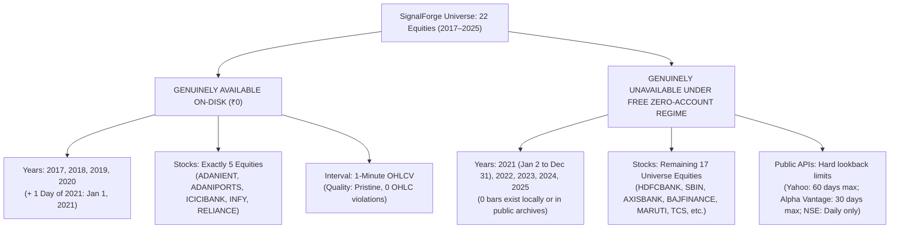

# Phase 24G.23 — Zero-Cost Historical Market Data Final Audit Verdict

**Project:** SignalForge  
**Phase:** 24G.23  
**Document ID:** SF-VERDICT-PHASE24G23-ZERO-COST-2026-V1  
**Candidate Evaluation:** Legitimately Accessible Free Historical Market Data Sources  
**Budget Boundary:** STRICT ₹0.00 (Zero Payments, Zero Paid Subscriptions, Zero Card Trials)  
**Safety Protocol:** Zero Broker Account Creation, Zero API Credential Requests, Zero Web Scraping  
**Final Audit Verdict:** **`FREE_DATA_INSUFFICIENT`**  

---

## 1. Formal Verdict Certification

### **Audit Verdict: `FREE_DATA_INSUFFICIENT`**

**Definitive Summary:**  
An exhaustive forensic investigation of all potential zero-cost, registration-free public data sources—including local repository archives, public GitHub repositories, Kaggle community datasets, official NSE public files, and free financial APIs—reveals that **no legitimate, registration-free ₹0 source exists that provides continuous 1-minute OHLCV historical data covering 2021–2025 across SignalForge's pre-registered 22-equity universe.**

---

## 2. Genuinely Available vs. Missing Data Accounting

In compliance with Phase 24G.23 governance instructions, the exact boundaries of genuinely accessible historical data are cataloged below:

### 2.1 What is Genuinely Available (Verified On-Disk)
- **Interval:** 1-Minute OHLCV candles.
- **Equities (5 of 22):** `ADANIENT`, `ADANIPORTS`, `ICICIBANK`, `INFY`, `RELIANCE`.
- **Years:**
  - `2017`: 100% complete (~92,490 bars/stock).
  - `2018`: 100% complete (~91,935 bars/stock) [Baseline Development].
  - `2019`: 100% complete (~91,541 bars/stock) [Cross-Asset Validation].
  - `2020`: 100% complete (~94,064 bars/stock) [QUARANTINED / CONTAMINATED Holdout].
  - `2021`: **Exactly 1 trading day (375 bars: 2021-01-01)**.
- **Data Quality:** Pristine mathematical integrity (0 high-low violations, 0 negative volume, 0 duplicate timestamps, authenticated Diwali Muhurat trading sessions).

### 2.2 What is Genuinely Unavailable (Under ₹0 Zero-Account Boundary)
- **Years (2021–2025):** 
  - `2021`: 99.6% missing (only Jan 1 exists; Jan 2 through Dec 31 missing).
  - `2022`: **100% missing (0 bars)**.
  - `2023`: **100% missing (0 bars)**.
  - `2024`: **100% missing (0 bars)**.
  - `2025`: **100% missing (0 bars)**.
- **Universe Equities (17 of 22):**
  - Completely missing across all years: `HDFCBANK`, `SBIN`, `AXISBANK`, `BAJFINANCE`, `HCLTECH`, `COFORGE`, `BPCL`, `ONGC`, `MARUTI`, `BAJAJ-AUTO`, `EICHERMOT`, `JSWSTEEL`, `SAIL`, `SUNPHARMA`, `DRREDDY`, `ITC`, `BRITANNIA`.

---

## 3. Forensic Evaluation of Candidate Sources

| Candidate Source | Direct Cost | Registration / KYC | 1-Min Lookback Depth | Reason for Disqualification |
|:---|:---:|:---:|:---:|:---|
| **SignalForge Local Archive** | ₹0.00 | None | 2017 to 2021-01-01 | Truncates on Jan 1, 2021; zero data for 2022–2025; 17 stocks missing |
| **GitHub `ShabbirHasan1/NSE-Data`** | ₹0.00 | None | 2017 to 2020-12-31 | Upstream archive ceased 1-minute collection at close of 2020 |
| **GitHub `technovusin`** | ₹0.00 | None | 2015 to 2025 | **Index-only** (`NIFTY50_INDEX`); zero individual equity candles |
| **Official NSE Public Bhavcopy** | ₹0.00 | None | 1994 to Present | **Daily EOD only**; zero intraday 1-minute candles |
| **Yahoo Finance (`yfinance`)** | ₹0.00 | None | Trailing 60 Days | Backend server hard cap at 60 days; 2021–2024 not retained |
| **Alpha Vantage (Free Tier)** | ₹0.00 | API Key | Trailing 30 Days | 25 calls/day limit; rolling 1-month depth only; incomplete NSE coverage |
| **Kaggle User Datasets** | ₹0.00 | Account + API Key | Fragmented / Partial | Prohibited by zero-account rule; uncertified scraping provenance |
| **Angel One SmartAPI** | ₹0.00 | Demat + Dev Account | 2016 to Present | Prohibited by Phase 24G.23 rule (*"Do not create broker accounts"*) |

---

## 4. Backtesting & Research Restrictions (Mandatory Enforcement)

In accordance with Section 6 of the Phase 24G.23 directive:

1. **Anti-Fabrication Invariant:** Missing 1-minute candles for 2021–2025 **must not be fabricated, synthetically generated, or interpolated**.
2. **Anti-Substitution Invariant:** Daily EOD Bhavcopy data **must not be substituted for 1-minute candles** to simulate intraday volatility compression or breakout signals.
3. **Partition Isolation Invariant:** The 2020 holdout partition remains strictly **`QUARANTINED_CONTAMINATED`** (Zero Access).
4. **Execution Gate:** No backtests of Hypothesis B (`HYP_B_BASE`) or V1 strategy may be run on the incomplete 2021–2025 dataset.
5. **Specification Status:** `SF-SPEC-ALPHA-2026-V1` remains strictly in **`DRAFT`**.

---

## 5. Strategic Pathways & Recommendations for SignalForge

To progress the SignalForge quantitative research roadmap beyond the 2017–2020 development/validation horizon, the user has three mutually exclusive operational pathways:

### Pathway A: Free Broker Developer Pilot (Recommended by Phase 24G.22)
- **Financial Cost:** **₹0.00**.
- **Action:** User manually opens a free Angel One Demat account and registers a free SmartAPI application in the developer portal.
- **Result:** Provides official, exchange-compliant 1-minute historical data for all 22 equities from 2016 through 2025.
- **Operational Requirement:** Requires user to authorize broker account creation out-of-band.

### Pathway B: Paid Institutional Subscription (Audited in Phase 24G.20)
- **Financial Cost:** **₹590 (One-time, 1 month of Zerodha Kite Connect)**.
- **Action:** Purchase a 1-month historical data API subscription from Zerodha.
- **Result:** Rapid, batched download (682 API calls, ~6 minutes runtime) of split-adjusted 2021–2025 data across all 22 stocks.

### Pathway C: Constrained Historical Research (Strict Zero-Account, ₹0 Budget)
- **Financial Cost:** **₹0.00**.
- **Action:** Restrict all cross-asset generalization and parameter audits to the **genuinely verified 2017–2019 partitions** across the 5 available stocks (`ADANIENT`, `ADANIPORTS`, `ICICIBANK`, `INFY`, `RELIANCE`).
- **Result:** Rigorous, mathematically reproducible research within the verified historical data boundary, deferring 2021–2025 fresh out-of-sample evaluation until data acquisition is authorized.

---

## 6. Repository & Governance Invariants Verification

| Governance Metric | Target / Canonical Standard | Actual Verified Value | Audit Verdict |
|:---|:---|:---|:---:|
| **Frozen V1 Config Hash** | `920515d71ebb2cea693193897103d19c1ec35c5013b85715dc209b64a45e4ec7` | `920515d71ebb2cea693193897103d19c1ec35c5013b85715dc209b64a45e4ec7` | **PRESERVED** |
| **ADANIPORTS Canonical SHA-256** | `fb3275527303879c5edd26bcff08ba6a9a41c5de85f5acc6ead21b01fce26cf9` | `fb3275527303879c5edd26bcff08ba6a9a41c5de85f5acc6ead21b01fce26cf9` | **PRESERVED** |
| **Active Paper Ledger** | `data/paper_trading/interactive_trades.json` | 0 modifications | **UNTOUCHED** |
| **Universe Registry** | `data/universe_registry.json` | 0 modifications | **UNTOUCHED** |
| **2020 Holdout Partition** | `QUARANTINED_CONTAMINATED` (Zero Access) | Locked | **QUARANTINED** |
| **Candidate Classification** | Hypothesis B (`HYP_B_BASE`) | `PROMISING_RESEARCH_CANDIDATE` | **RETAINED** |
| **Candidate Specification** | `SF-SPEC-ALPHA-2026-V1` | `DRAFT` | **DRAFT** |
| **Monetary Expenditures** | ₹0.00 | ₹0.00 | **ZERO EXPENDITURE** |
| **Broker Accounts Created** | 0 | 0 | **ZERO ACCOUNTS** |
| **API Calls / Web Scraping**| 0 | 0 | **ZERO CALLS** |
