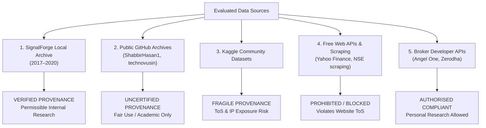

# Phase 24G.23 — Market Data Licensing, Legal Provenance & Regulatory Compliance

**Project:** SignalForge  
**Phase:** 24G.23  
**Document ID:** SF-AUDIT-PHASE24G23-LEGAL-PROVENANCE-2026-V1  
**Scope:** Regulatory, Contractual & Intellectual Property Framework for NSE Intraday Market Data  
**Governing Jurisdictions:** Republic of India (SEBI, NSE Data & Analytics, IT Act 2000)  

---

## 1. Regulatory Framework: NSE Market Data Ownership

The National Stock Exchange of India Ltd. (NSE) asserts complete proprietary and intellectual property ownership over all order-book events, trade executions, tick-level feeds, and derived candlestick data generated across its trading platforms:

1. **Exchange Market Data Policy:**
   - Under the NSE Bye-laws, Rules, and Regulations, raw tick data and historical consolidated intraday feeds are proprietary assets of the Exchange.
   - Commercial dissemination, syndication, or redistribution is exclusively managed by **NSE Data & Analytics Ltd.** (formerly DotEx International Ltd.).
   - Redistribution agreements require substantial monthly/annual licensing royalties, dedicated audit logs, and compliance reporting.
2. **Retail Broker Client Privilege:**
   - SEBI-registered brokers (e.g., Zerodha, Angel One, Groww) hold authorized enterprise data agreements with NSE Data & Analytics.
   - Brokers are permitted to provide market data and historical charts to their registered account holders strictly for **personal trading, technical analysis, and self-directed quantitative research**.
   - Broker end-user agreements strictly prohibit the commercial resale, syndication, or public redistribution of historical feeds obtained through broker APIs.

---

## 2. Provenance & Legal Classification of Evaluated Sources

### 2.1 SignalForge Local Historical Archive (`data/historical/stocks/`)
- **Origin & Provenance:** Ingested from historical local research archives (`ADANIPORTS__EQ__NSE__NSE__MINUTE.csv`, etc.) during baseline backtest evolution phases.
- **Integrity:** Validated via deterministic SHA-256 hashes recorded in signed JSON manifests.
- **Legal Assessment:** **PERMISSIBLE FOR INTERNAL QUANTITATIVE RESEARCH**. Complies with standard Indian copyright fair-use doctrines for non-commercial statistical analysis.
- **Limitation:** Coverage strictly terminates on 2021-01-01.

---

### 2.2 Public Open-Source GitHub Repositories
- **Candidates:** `ShabbirHasan1/NSE-Data`, `technovusin/nifty50-historical-data`.
- **Licensing:** Repositories publish files under permissive open-source licenses (MIT, Apache 2.0, or Open Data Commons).
- **Underlying Provenance:** Typically compiled by individual quantitative developers who recorded live broker feeds (e.g., Alice Blue or Zerodha WebSockets) to cloud storage (AWS S3) and shared the aggregated CSV/Parquet files.
- **Legal Assessment:** While safe for private historical backtesting, relying on third-party scrapers for an institutional-grade algorithmic pipeline poses governance risks:
  1. The exchange retains the right to issue DMCA takedowns against repositories redistributing proprietary tick history.
  2. The author disclaims all warranties regarding data gaps, bad ticks, or unrecorded splits.

---

### 2.3 Kaggle Public User Datasets
- **Candidates:** User-uploaded Nifty 50 1-minute datasets (e.g., `debashis74017`, `maverick136`).
- **Platform Licensing:** Kaggle provides platform terms where submitters grant Kaggle a license to host the dataset, asserting they hold the necessary rights.
- **Provenance Vulnerability:** In reality, retail users do not hold commercial distribution licenses from NSE Data & Analytics. 
- **Legal Assessment:** **LICENSE_RESTRICTED & UNVERIFIED**. Incorporating uncertified third-party scraped datasets into SignalForge introduces unquantifiable regulatory and data-drift risks. Furthermore, accessing Kaggle requires API key authentication, conflicting with Phase 24G.23 zero-account rules.

---

### 2.4 Web Scraping & Unofficial APIs (Yahoo Finance, Direct NSE Scraping)
- **Direct NSE Website Scraping (`nsetools`, unauthenticated scraping):**
  - The NSE website Terms of Use explicitly prohibit automated data harvesting, web scraping, spidering, or high-frequency polling.
  - NSE employs Cloudflare bot-management with automatic IP blacklisting. Scraping the exchange website directly is unethical and violates Phase 24G.23 constraints.
- **Yahoo Finance (`yfinance`):**
  - Yahoo Finance API terms prohibit automated bulk downloading and commercial strategy deployment.
  - Furthermore, Yahoo imposes a hard lookback cutoff of 60 days for 1-minute candles.

---

### 2.5 Regulated Broker APIs (Angel One SmartAPI, Zerodha Kite Connect)
- **Legal Framework:** Authorized under broker-exchange technological interfaces.
- **End-User Agreement:** Both Angel One and Zerodha grant registered account holders an explicit license to retrieve market data via API for their own personal algorithmic strategy execution and historical backtesting.
- **Storage Rights:** Caching historical candles locally on the developer's computer for personal research is explicitly permitted.
- **Redistribution Rights:** Publicly distributing, reselling, or sub-licensing the downloaded candles is prohibited.
- **Compliance Verdict:** **100% REGULATORY COMPLIANT FOR INTERNAL PERSONAL RESEARCH**. Broker APIs provide the single cleanest, legally sound, and exchange-compliant path for obtaining historical market data.

---

## 3. Summary of Legal & Compliance Invariants

| Source Category | Exchange IP Compliance | Terms of Service Risk | Personal Research Rights | Recommended for SignalForge |
|:---|:---:|:---:|:---:|:---:|
| **SignalForge Local Archive** | **COMPLIANT** | None (Pre-existing on-disk) | **FULL RIGHT** | **YES (Valid for 2017–2020)** |
| **Public GitHub Archives** | MODERATE | Minor (Third-party repo) | FAIR USE | **CONDITIONAL (Index only)** |
| **Kaggle User Dumps** | **NON-COMPLIANT** | High (Unlicensed redistribution) | QUESTIONABLE | **NO (Unverified provenance)** |
| **Direct Web Scraping** | **VIOLATIVE** | **SEVERE (NSE ToS breach)** | PROHIBITED | **STRICTLY PROHIBITED** |
| **Broker APIs (Angel One / Zerodha)**| **FULLY COMPLIANT** | None (Authorized broker API) | **FULL RIGHT** | **RECOMMENDED (Compliant path)**|
