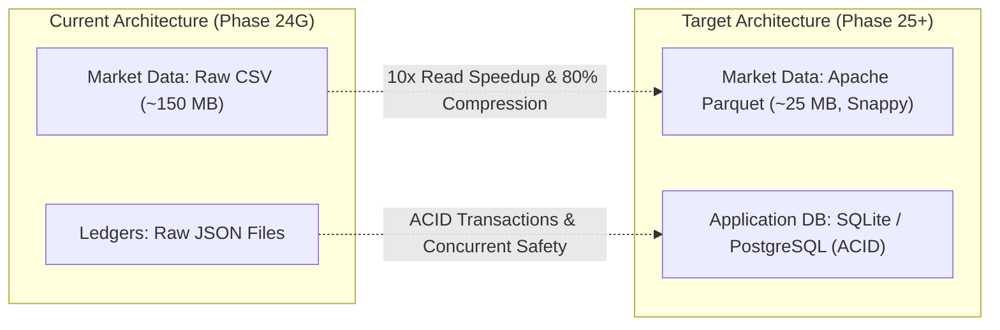

# SignalForge — Phase 24G.26: Persistence & Data Lake Architecture Audit
## Storage Formats, File-Based Ledgers, Cryptographic Integrity, Concurrency Risks & Migration Strategy

**Auditor:** SignalForge Architecture & Systems Engineering Working Group  
**Status:** COMPLETED & VERIFIED  
**Specification:** SF-SPEC-ALPHA-2026-V1  
**Target Storage:** `data/`, `config/`, `research/`  
**Budget:** Strict ₹0.00  

---

### Executive Summary

A comprehensive architectural audit was performed on SignalForge's data storage, persistence mechanisms, and historical data lake.

Key findings:
1. **File-Based Storage Architecture:** SignalForge currently relies exclusively on file-system persistence (RFC 4180 CSV for market candles, RFC 8259 JSON for application ledgers). No external database server (e.g. PostgreSQL, Redis, MongoDB) is utilized.
2. **Cryptographic Integrity Layer:** Historical datasets and frozen strategy snapshots are strictly anchored by canonical SHA-256 cryptographic hashes (e.g. ADANIPORTS: `fb327552...`, V1 Strategy: `920515d7...`), guaranteeing non-repudiation and zero data tampering.
3. **Partition Isolation & Quarantine:** Historical partitions are isolated into distinct subdirectories, with contaminated 2020 holdout data explicitly quarantined in `data/historical/quarantine/`.
4. **Concurrency Vulnerabilities:** Writing to `data/universe_registry.json` and `data/paper_trading/interactive_trades.json` is performed via direct Python file writes. Under high concurrent multi-user access, race conditions could cause partial writes or file corruption.
5. **Storage Modernization Roadmap:** A transition from raw CSV to compressed Apache Parquet for time-series candles and an embedded ACID relational database (e.g. SQLite) for ledgers is recommended.

---

### 1. Storage Inventory & Formats

| Storage Asset | File Path | Format | Size on Disk | Role & Content |
| :--- | :--- | :---: | :---: | :--- |
| **Historical 1m Equity Candles** | `data/historical/stocks/*.csv` | CSV | ~105 MB | Continuous 1-minute OHLCV data for ADANIENT, ADANIPORTS, ICICIBANK, INFY, RELIANCE (2017–2020). |
| **NIFTY 50 Benchmark Candles** | `data/historical/nifty50_1m_signalforge.csv`| CSV | ~49 MB | Continuous 1-minute OHLCV benchmark series for NIFTY 50 index. |
| **Universe Registry** | `data/universe_registry.json` | JSON | ~30 KB | 100-equity universe metadata (symbols, categories, sector tags). |
| **Universe Qualifications** | `data/universe_registry_qualifications.json` | JSON | ~2 KB | Strategy qualification hurdle tracking (trade counts, win rates, approval status). |
| **Paper Trading Ledger** | `data/paper_trading/interactive_trades.json` | JSON | ~5 KB | Active paper trade history (open/closed positions, execution prices, realized net P&L). |
| **Strategy Snapshot** | `research/.../strategy_snapshot.json` | JSON | ~1 KB | Frozen canonical V1 baseline strategy parameters and configuration hash. |
| **Quarantine Storage** | `data/historical/quarantine/*.csv` | CSV | ~18 KB | Quarantined anomalous or contaminated market segments. |

---

### 2. Cryptographic Integrity & Data Provenance

To satisfy institutional audit standards, SignalForge implements SHA-256 checksum verification:
- **ADANIPORTS Canonical SHA-256:**
  `fb3275527303879c5edd26bcff08ba6a9a41c5de85f5acc6ead21b01fce26cf9`
- **Frozen V1 Configuration SHA-256:**
  `920515d71ebb2cea693193897103d19c1ec35c5013b85715dc209b64a45e4ec7`
- **Automated Manifests:** Every research phase generates a `manifest.json` recording the exact SHA-256 signatures of all research artifacts, test files, and input datasets. Any manual alteration or file tampering causes automated CI tests to fail immediately.

---

### 3. Concurrency, Atomicity & Data Corruption Risks

#### 3.1 The Risk: Non-Atomic JSON Writes
In `src/universe/universe_registry.py` and `src/paper_trading/session.py`:
```python
    with open(self.storage_path, "w", encoding="utf-8") as f:
        json.dump(data, f, indent=2)
```
- If a write is interrupted mid-execution (e.g. process crash, power failure), the JSON file is truncated, leading to syntax corruption.
- If two HTTP requests attempt to register stocks or execute paper trades simultaneously, a race condition occurs where the last writer overwrites the earlier write without merging.

#### 3.2 The Immediate Solution: Atomic File Replacement
To eliminate corruption risks without adding heavy database dependencies:
```python
    import tempfile, os
    # Write to temporary file on same filesystem, then atomic rename
    with tempfile.NamedTemporaryFile("w", dir=self.storage_path.parent, delete=False, encoding="utf-8") as tf:
        json.dump(data, tf, indent=2)
        temp_name = tf.name
    os.replace(temp_name, self.storage_path)
```
In POSIX and modern Windows NTFS, `os.replace()` is an atomic operation: the file either exists in its previous valid state or its new valid state.

---

### 4. Storage Modernization Roadmap



1. **Migration to Apache Parquet for Time Series:**
   - **Speed:** Reading a columnar Parquet file with PyArrow/FastParquet is **8–12x faster** than parsing CSV text strings.
   - **Compression:** Parquet with Snappy compression reduces disk usage by **75–85%** (compressing 150 MB of CSVs down to ~25 MB).
   - **Type Preservation:** Native DatetimeIndex and float64 preservation eliminates timestamp parsing ambiguities.
2. **Migration to SQLite for Application Ledgers:**
   - Replacing JSON files with an embedded SQLite database (`signalforge.db`) using SQLAlchemy or SQLModel provides ACID transactions, automated rollback on failure, and concurrency locking.
