# SignalForge — Phase 24G.26: System Architecture & Data Flow Map
## Structural Component Architecture, Inter-Module Communication & End-to-End Data Trajectories

**Auditor:** SignalForge Architecture & Systems Engineering Working Group  
**Status:** COMPLETED & VERIFIED  
**Specification:** SF-SPEC-ALPHA-2026-V1  
**Budget:** Strict ₹0.00  

---

### 1. High-Level Architectural Diagram

The diagram below reflects the verified existing components of the SignalForge platform across all tiers:

```mermaid
flowchart TD
    subgraph Frontend["Frontend Tier (React 19 + Vite 8)"]
        UI_Nav["App Navigation & Views Router"]
        V_Chart["Stock Analysis & Lightweight Charts"]
        V_Scanner["Stock Scanner View"]
        V_Universe["Stock Universe & Governance View"]
        V_Paper["Paper Trading Execution View"]
        V_Intel["Market Intelligence View"]
        V_Settings["Preferences & Settings View"]
        API_Client["API Client Layer (src/api.js)"]
        
        UI_Nav --> V_Chart
        UI_Nav --> V_Scanner
        UI_Nav --> V_Universe
        UI_Nav --> V_Paper
        UI_Nav --> V_Intel
        UI_Nav --> V_Settings
        V_Chart --> API_Client
        V_Scanner --> API_Client
        V_Universe --> API_Client
        V_Paper --> API_Client
        V_Intel --> API_Client
    end

    subgraph BackendAPI["Backend API Layer (FastAPI)"]
        Router_Main["src/api/main.py (CORS + Routing)"]
        R_Health["/api/health"]
        R_Nifty["/api/nifty/*"]
        R_Stocks["/api/stocks/*"]
        R_Universe["/api/universe/*"]
        R_Paper["/api/paper-trading/*"]
        R_Intel["/api/intelligence/*"]
        R_Strategy["/api/strategy/*"]
        
        API_Client -.->|"HTTP / JSON (REST)"| Router_Main
        Router_Main --> R_Health
        Router_Main --> R_Nifty
        Router_Main --> R_Stocks
        Router_Main --> R_Universe
        Router_Main --> R_Paper
        Router_Main --> R_Intel
        Router_Main --> R_Strategy
    end

    subgraph DomainServices["Domain Services & Engines"]
        S_Univ["Universe Manager (StockUniverseRegistry)"]
        S_Val["Stock Validation Service"]
        S_Intel["Market Intelligence & State Classifier"]
        S_Paper["Paper Trading Session & Ledger Engine"]
        S_Signal["Signal Engine (generate_signal)"]
        S_Risk["RiskEngineV2 (Sizing, Costs, Trailing)"]
        S_Cursor["Causal Timeframe Cursor & Resampler"]
        
        R_Universe --> S_Univ
        R_Stocks --> S_Val
        R_Intel --> S_Intel
        R_Paper --> S_Paper
        R_Strategy --> S_Signal
        R_Nifty --> S_Cursor
        S_Paper --> S_Risk
        S_Signal --> S_Risk
    end

    subgraph StorageLayer["Persistence & Historical Data Lake"]
        DB_Univ["data/universe_registry.json"]
        DB_Qual["data/universe_registry_qualifications.json"]
        DB_Paper["data/paper_trading/interactive_trades.json"]
        FS_Hist["data/historical/stocks/*.csv (1m OHLCV)"]
        FS_Nifty["data/historical/nifty50_1m_signalforge.csv"]
        FS_Quarantine["data/historical/quarantine/*"]
        
        S_Univ <-->|"Atomic Read/Write"| DB_Univ
        S_Univ <-->|"Atomic Read/Write"| DB_Qual
        S_Paper <-->|"Read/Append/Close"| DB_Paper
        S_Cursor <-->|"Read Only"| FS_Hist
        S_Cursor <-->|"Read Only"| FS_Nifty
        S_Val <-->|"Read Only"| FS_Hist
        S_Val -.->|"Quarantine Anomaly"| FS_Quarantine
    end
```

---

### 2. End-to-End Data Flow Trajectories

To understand how SignalForge operates in production, let us trace three primary execution flows:

#### Trajectory A: Interactive Stock Analysis & Chart Visualization
1. **User Action:** The user selects `RELIANCE` on the `15m` timeframe in [`StockAnalysisView.jsx`](file:///c:/Study%20Roadmap/PROJECTS/SignalForge/frontend/src/StockAnalysisView.jsx).
2. **API Request:** Frontend calls `fetchStrategySignal("RELIANCE", "15m")` $\rightarrow$ `GET /api/strategy/signal?symbol=RELIANCE&timeframe=15m`.
3. **Backend Routing:** FastAPI dispatches to [`src/api/routes/strategy.py`](file:///c:/Study%20Roadmap/PROJECTS/SignalForge/src/api/routes/strategy.py).
4. **Data Sourcing:** The route handler loads continuous 1-minute historical bars for `RELIANCE` from `data/historical/stocks/RELIANCE_1m.csv`.
5. **Causal Multi-Timeframe Alignment:** The engine passes 1m data to `calculate_timeframe_indicators()`, which resamples into 5m, 10m, 15m, and 30m candles, computing EMA20, EMA50, RSI(14), ATR(14), and RVOL(20).
6. **Signal Rule Evaluation:** The latest completed states are fed into `generate_signal()`. If RSI $\ge 60$ and EMA alignment holds, it emits `Signal.BUY`.
7. **JSON Response:** Serialized into Pydantic schema `StrategySignalResponse` (signal, confidence, scores, levels) and returned to the browser.
8. **Frontend Rendering:** Lightweight Charts displays the candlestick series with indicator overlays and entry/stop/target price brackets.

#### Trajectory B: Universe Stock Qualification Inspection
1. **User Action:** The user navigates to [`StockUniverseView.jsx`](file:///c:/Study%20Roadmap/PROJECTS/SignalForge/frontend/src/StockUniverseView.jsx) and filters by `NIFTY_50`.
2. **API Request:** Frontend calls `fetchUniverseStocks("NIFTY_50")` $\rightarrow$ `GET /api/universe/stocks?category=NIFTY_50`.
3. **Registry Query:** [`StockUniverseRegistry`](file:///c:/Study%20Roadmap/PROJECTS/SignalForge/src/universe/universe_registry.py) reads `data/universe_registry.json`, filters instruments where `category == "NIFTY_50"`.
4. **Governance Verification:** The view checks qualification status from `data/universe_registry_qualifications.json` to verify whether the stock has satisfied minimum trade thresholds (30 required, 50 preferred).
5. **Display:** Renders tabular constituent rows with qualification badges (`DISQUALIFIED`, `BENCHMARK_VALIDATED`, `PROBATIONARY`).

#### Trajectory C: Paper Trade Manual Lifecycle
1. **User Action:** User clicks "Open Paper Trade" on a valid `BUY` signal in [`StrategySignalPanel.jsx`](file:///c:/Study%20Roadmap/PROJECTS/SignalForge/frontend/src/StrategySignalPanel.jsx).
2. **Order Submission:** `POST /api/paper-trading/trades` with payload containing symbol, side, entry price, stop-loss, and target.
3. **Risk Verification:** [`src/paper_trading/engine.py`](file:///c:/Study%20Roadmap/PROJECTS/SignalForge/src/paper_trading/engine.py) checks leverage bounds ($L \le 5.0\times$) and whole-share sizing constraints.
4. **Ledger Persistence:** The open position is appended to `data/paper_trading/interactive_trades.json` with status `OPEN`.
5. **Trade Management:** Subsequent price ticks update unrealized P&L. When stop-loss or profit-target is breached, the trade is finalized with status `CLOSED`, recording realized gross P&L, statutory friction, and net P&L.

---

### 3. Separation of Concerns & Architectural Boundaries

| Layer | Responsibility | Isolation Enforced |
| :--- | :--- | :--- |
| **Presentation (Frontend)** | User interactions, chart rendering, input validation, state transitions | Pure client-side; zero business logic; zero direct file/broker access. |
| **API Gateway (FastAPI)** | URL routing, query parameter validation, response serialization, CORS | Stateless HTTP boundaries; dispatches all domain logic to services. |
| **Domain Services** | Portfolio state, ledger tracking, opportunity scoring, stock qualification | Encapsulated Python classes; decoupled from web framework. |
| **Quantitative Engine** | Resampling, indicators, signal logic, backtesting, risk calculations | Pure functional/vectorized math; independent of persistence layer. |
| **Persistence (Storage)** | File-based JSON ledgers, historical CSV datasets, manifest provenance | File system abstraction; strict isolation of quarantined partitions. |
