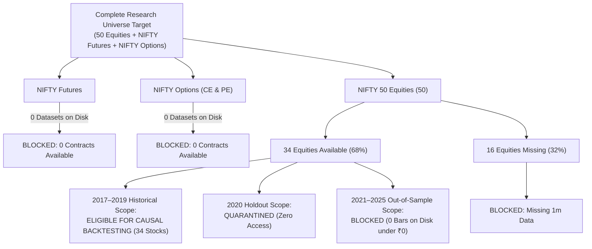

# SignalForge Phase 25A — Testing Eligibility & Instrument Readiness Report

**Phase:** 25A  
**Universe Scope:** 50 NIFTY 50 Equities, NIFTY Futures, NIFTY Options  
**Classification Standard:** Causal availability, complete 1m candles, zero data fabrication  

---

## 1. Instrument Testing Eligibility Summary

---

## 2. Exact List of Instruments Eligible for Backtesting

### A. Equities (Strictly for 2017-01-02 to 2019-12-31 Historical Research):
The following **34 stocks** are eligible for quantitative backtesting, parameter stability evaluation, and multi-symbol portfolio modeling:

1. **ADANIENT** (Canonical Clean)
2. **ADANIPORTS** (Canonical Clean)
3. **APOLLOHOSP** (Raw Archive — Validated)
4. **ASIANPAINT** (Raw Archive — Validated)
5. **AXISBANK** (Raw Archive — Validated)
6. **BAJAJ-AUTO** (Raw Archive — Validated)
7. **BAJFINANCE** (Raw Archive — Validated)
8. **BAJAJFINSV** (Raw Archive — Validated)
9. **BEL** (Raw Archive — Validated)
10. **BHARTIARTL** (Raw Archive — Validated)
11. **CIPLA** (Raw Archive — Validated)
12. **COALINDIA** (Raw Archive — Validated)
13. **DRREDDY** (Raw Archive — Validated)
14. **EICHERMOT** (Raw Archive — Validated)
15. **GRASIM** (Raw Archive — Validated)
16. **HCLTECH** (Raw Archive — Validated)
17. **HDFCBANK** (Raw Archive — Validated)
18. **ICICIBANK** (Canonical Clean)
19. **ITC** (Raw Archive — Validated)
20. **INFY** (Canonical Clean)
21. **JSWSTEEL** (Raw Archive — Validated)
22. **KOTAKBANK** (Raw Archive — Validated)
23. **LT** (Raw Archive — Validated)
24. **M&M** (Raw Archive — Validated)
25. **MARUTI** (Raw Archive — Validated)
26. **NTPC** (Raw Archive — Validated)
27. **NESTLEIND** (Raw Archive — Validated)
28. **ONGC** (Raw Archive — Validated)
29. **POWERGRID** (Raw Archive — Validated)
30. **RELIANCE** (Canonical Clean)
31. **SBILIFE** (Raw Archive — Validated, starts 2017-10-03)
32. **SHRIRAMFIN** (Raw Archive — Validated)
33. **SBIN** (Raw Archive — Validated)
34. **SUNPHARMA** (Raw Archive — Validated)

### B. Derivatives (Futures & Options):
- **NIFTY Futures:** **0 Eligible Instruments** (`BLOCKED_NO_DATA`).
- **NIFTY Options (CE):** **0 Eligible Instruments** (`BLOCKED_NO_DATA`).
- **NIFTY Options (PE):** **0 Eligible Instruments** (`BLOCKED_NO_DATA`).

---

## 3. Strict Pre-Conditions for Backtesting

1. **Backtesting Scope:** Backtesting must strictly target the historical 2017–2019 window.
2. **Strategy Codebase:** Backtest runs must evaluate frozen V1 or explicit new candidate versions without altering the frozen baseline hash (`920515d71ebb2cea693193897103d19c1ec35c5013b85715dc209b64a45e4ec7`).
3. **Execution Modeling:** Fills must use next-bar open or realistic slippage models with statutory transaction costs (brokerage, STT, exchange turnover fees, GST, stamp duty).

